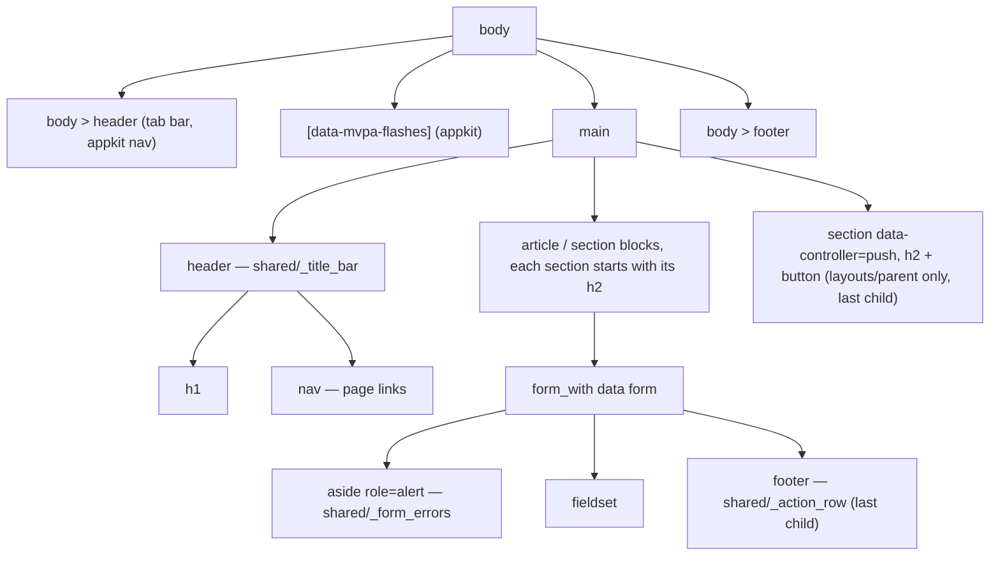
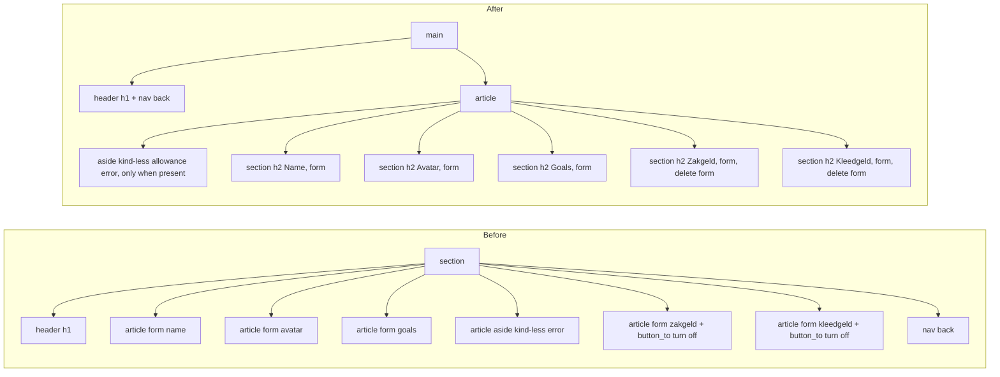

# Plan: Align views with journal_administration patterns

From `intent.md` (2026-11-06). Status: accepted.

## Design

### Domain terms

The glossary (`GLOSSARY.md`) does not exist yet, so no word of the intent conflicts with an agreed term. This plan uses these words, taken from journal_administration and the mvpa.css changelog. They are not glossary terms until Etienne agrees them.

- **Title bar** — the `<header>` that is a direct child of `<main>`: the page `<h1>`, then a `<nav>` with the page links. Rendered by `shared/_title_bar`.
- **Action row** — the `<footer>` that is the last child of a form: Delete (optional), Cancel, Save, in that DOM order. Rendered by `shared/_action_row`.
- **Form errors** — the alert `<aside>` with an `<h2>` that counts the errors and a `<ul>` of messages. Rendered by `shared/_form_errors`.
- **Data form** — a `form_with` form with input fields. A **one-button form** is a `button_to` form with no fields (give sticker, give penalty, mark rewarded, mark given, admin delete). Only a data form gets an action row.
- **Allowance summary** — the `<dl>` of each allowance kind and what is owed. Rendered by `shared/_allowances`.
- **Stacking table** — a `<table data-stack>` with the ARIA roles and `data-label`s from the mvpa changelog of 2026-10-19.

### Diagrams

Page structure after the change (every page in `layouts/parent` and `layouts/child`):

Child edit page (`parent/children/edit`), before and after:

### Signatures

No Ruby class or method changes. The new partials declare strict locals:

- `app/views/shared/_title_bar.html.erb` — page header with `<h1>` and an optional `<nav>` filled from the block: `<%# locals: (title:, heading_id: nil) %>`. `title` may be an HTML-safe string.
- `app/views/shared/_form_errors.html.erb` — alert with a counted `<h2>`, renders nothing without errors: `<%# locals: (record:) %>`.
- `app/views/shared/_action_row.html.erb` — form footer, Delete, Cancel, Save: `<%# locals: (form:, cancel_path:, submit_label: nil, delete_form_id: nil, delete_label: nil) %>`.
- `app/views/shared/_delete_form.html.erb` — empty DELETE form that a button elsewhere submits through `form=`: `<%# locals: (record:, url:) %>`.
- `app/views/shared/_allowances.html.erb` — allowance summary `<dl>`, renders nothing when the child has no allowance: `<%# locals: (child_profile:, payments_path: nil) %>`. With a `payments_path`, an owed kind gets the "Mark given" one-button form in its `<dd>`. The partial never checks the viewer's role.

Not checked: the change adds no Ruby, so `steep check` has nothing new to check. It still runs in CI and must stay green.

### Complexity

- The title bar, form errors, action row and delete form add no queries.
- `shared/_allowances` runs the same queries as the two blocks it replaces: one `owed_periods.count` per configured allowance (at most two per child). The child show page and the child dashboard each render it once.
- The parent dashboard (`parent/children/index`) does not render the allowance summary. `children_index_allowances_query_test` keeps its bound of two allowance queries.
- `layouts/parent` moves the push section inside `<main>`; it adds no query.

### Invariants

- Every app-owned page has exactly one `<h1>`, inside `main > header`. Enforced by `shared/_title_bar`, the only place that renders a page `<h1>` in this app's own views. The appkit views (login, preferences, and the overrides in `app/views/appkit/`) are the stated exception: the intent keeps them as they are, so their `<h1>` stays where it is.
- Every data form ends in `form > footer:last-child` with Cancel (`a[role=button].button-secondary`) and Save (submit). Enforced by `shared/_action_row`.
- A `<data>` element is never inside an `<a>`. No view in this change adds a `<data>` element inside a link.
- Every Turbo Stream target id stays on the root element of the partial that replaces it: `dom_id(child, :card)` (`child/dashboard/_card`), `:parent_card` (`parent/children/_child_card`), `:dashboard_progress` (`_dashboard_progress`, still a direct child `div` of the row), `:completion_flag`, and the `:notifications` append target. `:dashboard_row` is never a broadcast target (`child_profile_test` asserts that) and keeps its id for the system tests.
- `[data-mvpa-flashes]` stays outside `<main>` (appkit renders it before `<main>` in both layouts; this change does not touch that line).

### Alternatives

1. **Journal partials, adapted (chosen).** Copy `_title_bar`, `_form_errors`, `_action_row` and `_delete_form` from journal. Add `heading_id:` to the title bar and `delete_label:` to the action row, because this app has no generic "Delete…" and its admin table needs a heading id. Smallest diff that meets every criterion.
2. **Journal partials verbatim, admin table in a `<section>` with `<h2 id="users-heading">`** (the first architect's design; journal's `admin/dashboard` uses this shape). Keeps the title bar identical to journal, but adds a second heading for the same table and a new key in three languages. Rejected for that duplicate; its `payments_path:` local for the allowance summary and its form list are adopted.
3. **Fit first, from the second architect** — keep the confetti wrapper, page-scoped title bar restyle on the dashboard up front. Its fit analysis and wrapper choice are adopted; applying the restyle up front is rejected, because it makes the dashboard title bar differ from mvpa before a test shows it is needed.
4. **Helper methods instead of partials** (`title_bar(title) { … }` in `ApplicationHelper`). Needs Ruby, inline RBS and unit tests, and differs from journal, which the intent names as the pattern. Rejected.

## Design decisions

- **Which forms get an action row.** The intent says "every form"; its Problem section and in-scope item 4 describe forms whose Submit and Cancel sit in loose `<nav>` blocks. This plan reads "every form" as every data form, and reports the reading as a decision for Etienne: the five forms on the child edit page, the inline goal form on the child show card, the admin user form and the profile form. One-button forms (`button_to`) keep their single button: they have no fields to cancel. The empty `shared/_delete_form` has no buttons of its own. The appkit login and preferences forms are out of scope (intent constraint).
- **Cancel targets.** Child edit page forms cancel to `parent_children_path`, where the current back link goes. The inline goal form on the child show card cancels to `parent_child_path(child)`, which reloads the page and drops the typed text. Admin forms cancel as today (`cancel_path` local). The profile form cancels to `user_profile_path(@user)` as today.
- **Turn off allowance.** The action row of a persisted allowance gets `delete_form_id: dom_id(allowance, :delete)` and `delete_label: t("parent.allowances.turn_off")`. The button carries `class="button-danger"` and submits `shared/_delete_form`, rendered right after the update form inside the same `<section>`. No confirm dialog: there is none today, and adding one changes behaviour. A new (not persisted) allowance form shows Cancel and Save only.
- **Admin table heading id.** `admin/users/index` renders the title bar with `heading_id: "admin_users_heading"`; the `<table>` gets `aria-labelledby="admin_users_heading"`.
- **Child dashboard confetti wrapper.** The title bar moves out of the `div[data-controller=confetti]` wrapper and renders before it, so `main > header` is a direct child of `<main>`. The `div` keeps all four values and now wraps only the `<article>`. `child_flow_test`'s `div[data-confetti-completed-card-ids-value]` assertions and `child_cards.css` `[data-controller="confetti"] > article` keep matching, unchanged. The `#notifications` section gets no `<h2>`: `child_flow_test` asserts its first `article` child.
- **Child show page avatar.** The avatar moves into the title as `safe_join([image_tag(…, alt: ""), name], " ")`, so the title bar keeps it next to the name. `alt=""` because the name follows it in the same heading.
- **Sections outside the nine items keep their current headings.** The intent's outcome says each content block is a `<section>` that starts with an `<h2>`, but its in-scope list adds headings only on the child edit page and to the push section. This plan adds no `<h2>` to the child dashboard card, notifications or allowance blocks, or to the parent child card.
- **New locale keys** (en, nl, it): `common.cancel`, `common.save`, `parent.child_profile.edit.headings.{name,avatar,goals,zakgeld,kleedgeld}`, `parent.push.heading`. Zakgeld and Kleedgeld read "Zakgeld" and "Kleedgeld" in every locale (intent decision). Keys the change leaves unused (`users.profiles.edit.cancel`, `…edit.save`, `admin.users.form.cancel`, `parent.child_profile.edit.save` where unused, `parent.allowances.save`, `parent.history.back` if replaced) are removed, because `i18n-tasks health` in `test/i18n_test.rb` fails on unused keys. A key still read elsewhere stays.
- **Dashboard title bar fit.** The Settings link moves into the dashboard title bar. `dashboard_row.css` replaces the dead selector `main > section:has(> article[data-controller="confetti"]) > header h1` with `main:has(> article[data-controller="confetti"]) > header h1`, with the same declarations. Estimated cost at 375px: today the `<h1>` takes about 37px above row 1. With the title bar, the 44px link plus the mobile `header nav` block padding (0.5rem each side) makes it about 60–68px, so about +25–30px. "Instellingen" (about 122px) beside "Ouder Dashboard" (about 195px) just fits one line in the 359px content box; a wrapped title costs about +55px more. First, measure the slack: run the fit tests after the selector swap alone. If they fail, apply fallback (a), page-scoped in `dashboard_row.css` under `main:has(> article[data-controller="confetti"]) > header`: header `align-items: center; margin-block-end: 0.5rem`; its `nav` `padding: 0; background: none; overflow: visible`; its `h1` `margin: 0; white-space: nowrap; overflow: hidden; text-overflow: ellipsis`. The link keeps its 44px touch target; the title bar is then about 52px (+15px). Fallback (b), moving Settings back below the rows, breaks the criterion "links in a nav in that header" on that page; the implementer stops and reports it as a decision for Etienne instead of applying it. The fit test thresholds never change.
- **No conflict with intent `## Decisions`.** Every step keeps all nine items in one change, puts each heading first in its `<section>`, keeps the push button on every parent page inside a layout `<section>`, and uses the default heading labels.

## Integration points

- `Appkit::Engine` (gem `eirvandelden/appkit`): renders the tab bar, flashes, login and preferences. Untouched. The local overrides in `app/views/appkit/` are untouched.
- mvpa.css at locked revision `06778c8`: styles `main > header`, `main > header nav a`, `form > footer`, `table[data-stack]`, `.button-secondary`, `.button-danger`. No mvpa change.
- Turbo Streams: `Sticker`/`StickerCard`/`ChildProfile` broadcasts replace `_card`, `_child_card` and `_dashboard_progress` by id. Those partials keep their root element and id.
- Stimulus: `confetti` (values only, element type free), `push` (`data-action="push#subscribe"` on the button), `history-groups`, `fade-out`. Their attributes move with their elements unchanged.

## Files that change

- `app/views/shared/_title_bar.html.erb` — new, from journal, plus `heading_id:`.
- `app/views/shared/_form_errors.html.erb` — new, from journal, with this app's `errors.template.header` (count only).
- `app/views/shared/_action_row.html.erb` — new, from journal, plus `delete_label:`, Cancel as `link_to … role: "button", class: "button-secondary"`, Save as `form.submit`.
- `app/views/shared/_delete_form.html.erb` — new, from journal.
- `app/views/shared/_allowances.html.erb` — new, the allowance summary `<dl>`.
- `app/views/parent/children/index.html.erb` — drop the `<section>` wrapper; title bar with the Settings link; rows stay `article[data-controller=confetti]` direct children of `<main>`.
- `app/views/parent/children/show.html.erb` — title bar (avatar + name) with history and back links; drop the `<section>` wrapper and loose `<nav>`.
- `app/views/parent/children/_child_card.html.erb` — goal form gets an action row (Cancel, Save); allowance `
`s become `render "shared/allowances", child_profile: child, payments_path: parent_child_allowance_payments_path(child)`, inside the `#parent_card` root.
- `app/views/parent/children/edit.html.erb` — title bar with the back link; one `<article>` with five `<section>`s, each `<h2>` first; form errors and action rows from the shared partials; turn-off through `shared/_delete_form`.
- `app/views/parent/settings/index.html.erb` — drop the nested `<main>`; title bar; child links in an `<article>` `<nav>`.
- `app/views/parent/stickers/index.html.erb` — drop the `
` wrapper; title bar with the back link.
- `app/views/child/dashboard/show.html.erb` — title bar before the confetti `div`, which now wraps only the `<article>`; allowance block becomes `<section>` + `render "shared/allowances", child_profile: @child_profile`.
- `app/views/child/dashboard/_card.html.erb` — `article.stickers > section.*` becomes `ul.stickers > li.*`.
- `app/views/admin/dashboard/index.html.erb` — drop the `
` wrapper; title bar.
- `app/views/admin/users/index.html.erb` — title bar with the New user link and `heading_id`; stacking table markup (`data-stack="medium"`, roles, `data-label`s, `aria-labelledby`, `<time datetime>`).
- `app/views/admin/users/show.html.erb`, `new.html.erb`, `edit.html.erb` — drop the `
` wrapper; title bar.
- `app/views/admin/users/_form.html.erb` — form errors and action row.
- `app/views/users/profiles/show.html.erb` — title bar with the Edit link in its `<nav>`.
- `app/views/users/profiles/edit.html.erb` — title bar; form errors and action row.
- `app/views/layouts/parent.html.erb` — the push `<fieldset>` after `<main>` becomes `<section data-controller="push"><h2>…</h2><button type="button" …></section>` as the last child of `<main>`.
- `app/assets/stylesheets/3_modules/dashboard_row.css` — retarget the title `<h1>` selector; fallback rules only if the fit test needs them.
- `app/assets/stylesheets/3_modules/sticker_grid.css` — `article.stickers` → `ul.stickers` with `list-style: none; padding: 0`; `article.stickers section(.x)` → `ul.stickers > li(.x)` with `margin: 0` to cancel mvpa's `li` margin, so the grid looks as before.
- `config/locales/en.yml`, `nl.yml`, `it.yml` — new keys, unused keys removed, normalized.
- Tests: see `## Proof`. Existing selectors that this markup change makes stale are updated, never loosened: `child_flow_test` (`article.stickers` → `ul.stickers`, allowance `p` → `dt`/`dd`).

## Order of work

1. Write `test/integration/page_structure_test.rb` (first acceptance criterion: one `<h1>` in `main > header`, links in its `<nav>`, no wrapper). Run it, watch it fail.
2. Add `shared/_title_bar` and convert every page listed above to it. Retarget `dashboard_row.css`. On the child dashboard render the title bar before the confetti `div`. Run step 1's test green, then `bin/rails test test/system/parent_dashboard_fit_test.rb`. Apply fallback (a) only if it fails; if (a) is not enough, stop and report (see `## Design decisions`).
3. Child edit page headings test → red. Restructure `parent/children/edit` into one `<article>` with five `<section>`s; add the heading keys. Green.
4. Form errors test → red. Add `shared/_form_errors`; replace every pasted `<aside>`. Green.
5. Action row tests → red. Add `shared/_action_row` and `shared/_delete_form`; apply to every data form; add `common.cancel`/`common.save`; remove the now-unused keys. Green, including `allowances_controller_test`.
6. Allowance summary tests → red. Add `shared/_allowances`; use it on the parent card and child dashboard; update the `child_flow_test` allowance selectors. Green.
7. Admin stacking table test → red. Convert `admin/users/index`. Green. Add the stacking check to the system test (step 9).
8. Sticker list test → red. Convert `_card` and `sticker_grid.css`. Green.
9. Push section test → red. Move the push button in `layouts/parent`; add `parent.push.heading`. Green.
10. `<data>`-not-in-link test and locale test → write and run (both guards, green on arrival is expected for the `<data>` guard; say so in the commit).
11. Add `test/system/page_structure_test.rb` (cancel/save look, admin table stacking at 375px). Run it.
12. Full checks: `bin/rails test`, `bin/rails test:system`, `bin/rubocop`, `bin/erb_lint --lint-all --allow-no-files`, `npx @herb-tools/herb-lint`, `bundle exec ruby ./bin/check_i18n_normalized`, `bin/brakeman`, `steep check`. Manually load the dashboard, child show, child edit, admin users index and the child dashboard at 375px and at desktop width and look for overflow (`main` is an inline-size container).

## Risks

- **Dashboard fit.** The Settings link becomes a 44px bordered button in the title bar. mvpa's `main > header` is `align-items: baseline` and does not wrap, so the link should share the `<h1>` line, but a wrapped Dutch or Italian title would add a line. Mitigation: the fit test runs right after step 2, with the fallback order in `## Design decisions`.
- **herb-lint on table roles.** `role="table"`, `role="rowgroup"` and friends repeat the implicit role. The mvpa changelog asks for them (they keep the table semantics when `display` changes). If herb-lint flags them as redundant, that is a `Decision needed` for Etienne, never a disable comment or a config edit.
- **Duplicated user errors on the child edit page.** The name and avatar forms both bind to `@child.user`, so an avatar error also shows above the name form. This is current behaviour and stays; fixing it changes behaviour.
- **`main` as an inline-size container.** The admin table and the sticker grid are the widest content. The stacking table and the `auto-fill` grid follow the container. Step 12 checks them by eye.
- **Unused-key cleanup.** Removing a key that another view still reads breaks that view. `i18n-tasks unused` and `i18n-tasks missing` (via `test/i18n_test.rb` health) catch both directions.
- **Turbo Stream replacement.** A broadcast replaces `_card`/`_child_card` by id. The new `ul.stickers` and allowance `<dl>` live inside those roots, so a replacement renders the new markup. `stickers_turbo_stream_test` and `realtime_sticker_test` cover it.
- Rejected: a local `title_bar.css` (intent constraint; mvpa covers wrapping), a confirm dialog on Turn off (behaviour change), headings beyond the nine items (scope).

## Out of scope

Colours, fonts, theme tokens and new CSS design; behaviour, routes, controllers, models and Stimulus controllers; `app/views/appkit/**` and the appkit gem; moving the push button to another page; allowance features; the duplicated `@child.user` errors; the admin dashboard table (it is not the admin user table the intent names); new `<h2>`s outside the child edit page and the push section.

## Proof

- Every app-owned page (appkit views excepted, per the intent's constraint) has one `<h1>` inside a `<header>` that is a direct child of `<main>`, links in that header's `<nav>`, no wrapper → `test/integration/page_structure_test.rb` `test "every page has one h1 in main > header"` (iterates over parent dashboard, child show, child edit, settings, history, profile show and edit, admin dashboard, admin users index/show/new/edit, child dashboard) and `test "page links sit in the title bar nav"` (Settings on the dashboard, history and back on child show, back on child edit and history, New user on admin users, Edit on profile show).
- Child edit page shows five headings, each first in its `<section>` → `test/integration/parent/child_edit_sections_test.rb` `test "each child edit form sits in a section whose first child is its heading"` and `test "headings read in English, Dutch and Italian"`.
- One alert `<aside>` with a counting `<h2>` on every form with errors → `test/integration/form_errors_test.rb`, each asserting exactly one `aside[role=alert]` in the failing form and its `h2` text from `errors.template.header` with the right count: `test "child name form shows one counted alert"`, `test "child avatar form shows one counted alert"`, `test "child goals form shows one counted alert"`, `test "allowance create form shows one counted alert"`, `test "allowance update form shows one counted alert"`, `test "allowance without a kind shows one counted alert above the sections"`, `test "admin user form shows one counted alert"`, `test "profile form shows one counted alert"`.
- Every data form ends in a `<footer>` last child with Cancel and Save; Turn off sits first in that footer and is red → `test/integration/action_row_test.rb` `test "every data form ends in an action row with cancel and save"`, `test "persisted allowance footer starts with the red turn off button for the delete form"`, `test "turn off allowance still deletes through the delete form"`.
- Cancel is plain and Save is filled → `test/integration/action_row_test.rb` `test "cancel is a secondary role=button link before the submit"` and `test/system/page_structure_test.rb` `test "cancel reads plain next to a filled save"` (computed background of Cancel differs from Save's and equals the page surface).
- Allowance summary on the parent card and the child dashboard comes from one partial as `<dl>` → `test/integration/allowance_summary_test.rb` `test "parent card lists allowances as dt and dd with mark given"` and `test "child dashboard lists allowances as dt and dd without mark given"`; updated `test/integration/child_flow_test.rb` allowance tests.
- Admin user table has a heading id and `aria-labelledby`, stacks at phone width with labels → `test/integration/admin/users_test.rb` `test "users table is a labelled stacking table"` and `test/system/page_structure_test.rb` `test "admin users table stacks with cell labels on a phone"`.
- No `<data>` inside a link → `test/integration/page_structure_test.rb` `test "no data element sits inside a link"`.
- Child card lists stickers as `<li>` in a `<ul>`, empty slots show ⭐ → `test/integration/child_flow_test.rb` `test "child card lists stickers as list items with star slots"`.
- Push button inside `<main>` in a `<section>` with an `<h2>` on every parent page → `test/integration/page_structure_test.rb` `test "push button sits in a main section with a heading on parent pages"`.
- Three children with a card ready still fit → `test/system/parent_dashboard_fit_test.rb` (unchanged, all tests).
- New headings read in English, Dutch and Italian → `test/integration/parent/child_edit_sections_test.rb` `test "headings read in English, Dutch and Italian"`, `test/integration/page_structure_test.rb` `test "push heading reads in English, Dutch and Italian"`, and check: `bundle exec ruby ./bin/check_i18n_normalized` plus `test/i18n_test.rb` (`i18n-tasks health`).
- Query count: the parent dashboard issues at most two allowance queries → `test/integration/parent/children_index_allowances_query_test.rb` `test "index does not issue a query per child for allowances"` (unchanged).
- Query count: the allowance summary runs no more allowance queries than the blocks it replaces → `test/integration/allowance_summary_test.rb` `test "child show runs the same allowance queries as before"` and `test "child dashboard runs the same allowance queries as before"`. Before step 6, measure the count of `allowances`/`allowance_periods` queries on both pages on the current markup (fixture child `one`, two allowances) and write that number into both tests as the upper bound.
- Invariant: Turbo Stream targets keep their ids on the partial roots → `test/models/child_profile_test.rb` (existing broadcast tests, unchanged), `test/integration/page_structure_test.rb` `test "broadcast targets stay on their partial roots"` (asserts `section#…card`, `section#…parent_card`, `article#…dashboard_row > div#…dashboard_progress`, `span#…completion_flag`, `section#…notifications` on the rendered pages), and `test/system/realtime_sticker_test.rb` (unchanged).
- Invariant: `[data-mvpa-flashes]` stays outside `<main>` → `test/integration/flash_test.rb` plus a new `test "flashes render outside main"` in it.

Per changed file, the unit tests expected, named as behaviour:
- `app/views/shared/_title_bar.html.erb`: covered by `page_structure_test` (`renders the h1 in main > header`, `renders the nav only with links`, `sets the heading id when given`).
- `app/views/shared/_form_errors.html.erb`: covered by `form_errors_test` (`renders nothing without errors`, `counts the errors in its h2`).
- `app/views/shared/_action_row.html.erb`: covered by `action_row_test` (`orders delete, cancel, save`, `leaves delete out without a delete form id`).
- `app/views/shared/_allowances.html.erb`: covered by `allowance_summary_test` (`renders nothing without allowances`, `shows mark given only with a payments path and an owed period`).
- Partials are views, not public Ruby classes, so their tests are integration tests that render them through real pages.

Test setup: existing fixtures (`users`, `child_profiles`, `sticker_cards`, `stickers`, `allowances`, `allowance_periods`). Invalid forms are reached by real requests with invalid params (blank name, `amount_cents: 0`, mismatched admin password, oversized or wrong-type avatar via `test/fixtures/files/avatar.txt`). The emulation helpers of `parent_dashboard_fit_test` are private to that class, so step 11 adds `emulate_phone(width:, height:)` and `clear_phone_emulation` to `ApplicationSystemTestCase` (CDP `Emulation.setDeviceMetricsOverride` / `clearDeviceMetricsOverride`, cleared in `teardown`). `test/system/page_structure_test.rb` uses them. `parent_dashboard_fit_test.rb` is not edited, to honour the intent's constraint; its private copy stays. No faked boundaries.

---
Domain skills applied: rails-ui, rails-testing, software-design, diagrams, glossary, 37signals-style.

## Critique

### Round 1 (codex exec -p terra)

- "Every form" in the criterion also covers `button_to` forms and the empty delete form; the data-form reading has no Decision behind it → dismissed: the intent's Problem section and in-scope item 4 describe forms with Submit and Cancel in loose `<nav>` blocks, which one-button forms and the empty delete form do not have; wrapping a single action button in a Cancel/Save footer would change behaviour. The reading is named in `## Design decisions` and goes to Etienne as a decision line in the stage report.
- The Turbo invariant lists `dashboard_row` and `reward_badge` as targets, and `stickers_turbo_stream_test` only checks responses → fixed (invariant lists only `card`, `parent_card`, `dashboard_progress`, `completion_flag`, `notifications`; proof now names the existing `child_profile_test` broadcast tests and a new rendered-root test)
- The allowance query proof uses the dashboard, which does not render `_allowances` → fixed (two query-count tests on child show and child dashboard, bounded by a baseline measured before step 6)
- "Every page" includes the appkit preferences and session pages, which keep their `<h1>` outside `main > header` → fixed (invariant and proof scoped to app-owned pages, appkit exception stated)
- The new system test cannot reuse the fit test's private emulation → fixed (shared `emulate_phone`/`clear_phone_emulation` on `ApplicationSystemTestCase`; fit test file left unedited)
- The form-error proof omits the avatar, goals and kind-less allowance branches and does not assert the counted `<h2>` → fixed (one test per form branch, each asserting one alert and its counted heading)
