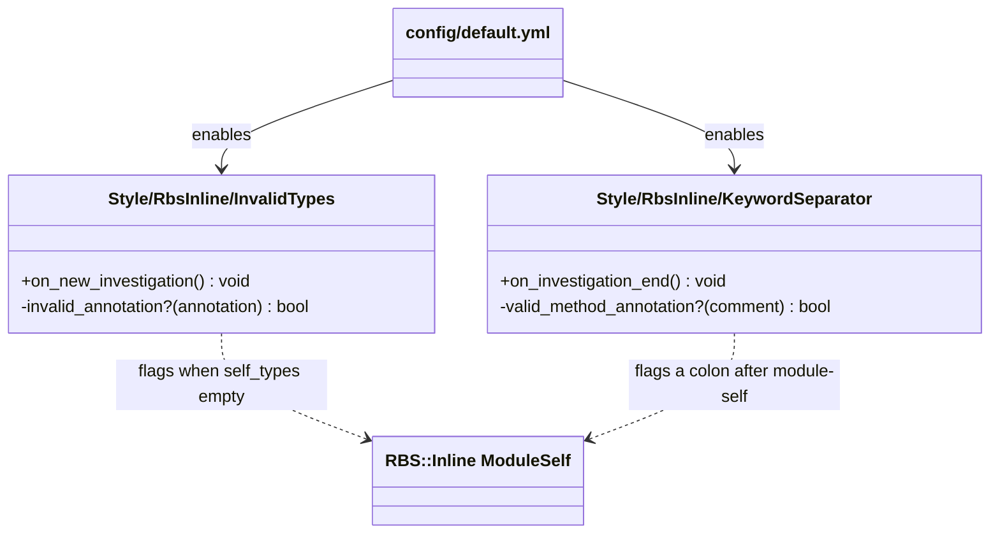
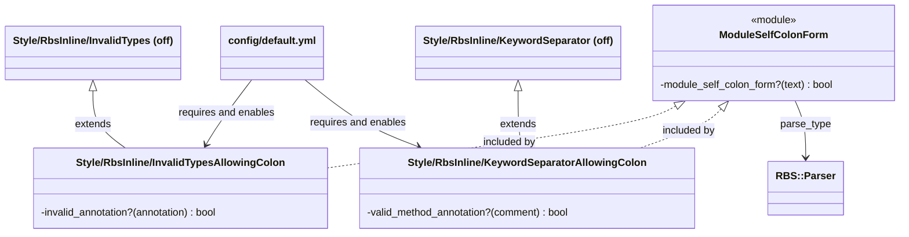

# Plan: Turn the lint job green and keep Steep green

From `intent.md` (2026-11-06). Status: accepted.

## Context

This change spans three repositories, each on its own branch and pull request:

1. `eirvandelden/rubocop-eirvandelden` (`~/Developer/rubocop-eirvandelden`): two validating cops that accept a valid `# @rbs module-self: X`.
2. `eirvandelden/appkit` (`~/Developer/appkit`): the shared `rails-ci.yml` runs `lint` and `scan_js` on `ubuntu-latest`.
3. `eirvandelden/sticker-app` (this worktree): picks up the new `rubocop-eirvandelden` revision in `Gemfile.lock`.

Facts verified while planning (2026-11-06 and 2026-11-07):

- The `db/queue_migrate` exclusion is already on `rubocop-eirvandelden` `main` (commit `d91402e`, "exempt run-once scripts from signature checks", with tests). Its glob `**/db/*_migrate/**/*` in `config/rails.yml` covers `db/cable_migrate`, `db/queue_migrate` and `db/cache_migrate`. sticker-app pins `32d259f`, so the bump alone removes that offense.
- `rubocop-rbs_inline` 2.0.0 has no config option on `InvalidTypes` or `KeywordSeparator`. A config-only fix cannot keep both cops' other checks and accept the colon form.
- rbs-inline 0.14 parses `# @rbs module-self: Foo` as `RBS::Inline::AST::Annotations::ModuleSelf` with empty `self_types`, so upstream `InvalidTypes#invalid_annotation?` returns true. For `#: (Integer -> void` it yields a `SyntaxErrorAssertion`, which stays an offense.
- Upstream `KeywordSeparator#on_investigation_end` skips a comment when its private `valid_method_annotation?(comment)` returns true. That is the one hook the subclass needs.
- RBS 4.2 (`RBS::InlineParser`, used by Steep 2.1 with `inline: true`) requires the colon after `module-self`.
- appkit inherits the same gem, generates `sig/` with the rbs-inline CLI and writes the bare form `# @rbs module-self ::ActiveRecord::Base`. That form must stay clean.
- A prototype of the design below, in a scratch copy of the gem, gives:
  - `# @rbs module-self: Foo` and `# @rbs module-self: Foo[Bar]`: no offenses.
  - `# @rbs module-self Foo` (bare form): no offenses.
  - `# @rbs module-self: Foo[`: `InvalidTypesAllowingColon` and `KeywordSeparatorAllowingColon` offenses.
  - `#: (Integer -> void`: an `InvalidTypesAllowingColon` offense.
  - `# @rbs skip:`, `# @rbs override:`, `# @rbs inherits: Foo`: a `KeywordSeparatorAllowingColon` offense each, as upstream.
  - The sticker-app files linted against the prototype config: "136 files inspected, no offenses detected".
- `steep check` with a regenerated `sig/` reports "No type error detected" on this branch today.
- `module Authorization` is declared in two files, `app/controllers/concerns/authorization.rb` and `app/models/concerns/authorization.rb`, both with `# @rbs module-self: ActionController::Base`. Steep merges both declarations. Removing the self type from only the controller file leaves `steep check` green. Removing it from both files gives `Type (::Object & ::Authorization) does not have method redirect_to`.
- CI run 42282988312: `ci / lint` and `ci / scan_js` fail on `ubuntu-slim` with `libcrypto.so.3: version OPENSSL_3.4.0 not found (required by .../openssl-4.0.2/lib/openssl.so) (LoadError)`. `ci / scan_ruby` on `ubuntu-slim` passes. `test` and `system-test` on `ubuntu-latest` pass.

## Design

### Domain terms

- **Validating cop** (glossary of `rubocop-eirvandelden`): a cop that checks an annotation that already exists and never requires one. Both new cops are validating cops.
- **Colon form** (new, proposed, not in a glossary yet): `# @rbs module-self: T`, the form RBS 4's inline parser and Steep require.
- **Bare form** (new, proposed, not in a glossary yet): `# @rbs module-self T`, the form the rbs-inline 0.14 generator reads.

### Diagrams

Before:



After:



ER: Not affected: no database. State: Not affected: nothing changes state.

### Signatures

All three files live in `rubocop-eirvandelden` under `lib/rubocop/cop/style/rbs_inline/`. None adds a public method.

`RuboCop::Cop::Style::RbsInline::ModuleSelfColonForm` (`module_self_colon_form.rb`): recognises a colon-form `module-self` comment whose type parses as RBS.

```ruby
require "rubocop-rbs_inline"

COLON_FORM = /\A#\s*@rbs\s+module-self:\s*(?<type>.+)\z/ #: Regexp

private
  # @rbs text: String
  def module_self_colon_form?(text) #: bool
    type = COLON_FORM.match(text.strip)&.[](:type) or return false
    !RBS::Parser.parse_type(type, require_eof: true).nil?
  rescue RBS::ParsingError
    false
  end
```

`RuboCop::Cop::Style::RbsInline::InvalidTypesAllowingColon < InvalidTypes` (`invalid_types_allowing_colon.rb`): checks inline RBS types like `InvalidTypes`, but accepts a valid colon form.

```ruby
require_relative "module_self_colon_form"
include ModuleSelfColonForm

private
  # @rbs annotation: RBS::Inline::AST::Annotations::t
  def invalid_annotation?(annotation) #: bool
    return false if annotation.is_a?(ModuleSelf) && annotation.source.comments.any? { module_self_colon_form?(it.slice) }

    super
  end
```

`RuboCop::Cop::Style::RbsInline::KeywordSeparatorAllowingColon < KeywordSeparator` (`keyword_separator_allowing_colon.rb`): flags a colon after an annotation keyword like `KeywordSeparator`, but accepts a valid colon form.

```ruby
require_relative "module_self_colon_form"
include ModuleSelfColonForm

private
  # @rbs comment: Parser::Source::Comment
  def valid_method_annotation?(comment) #: bool
    module_self_colon_form?(comment.text) || super
  end
```

- Both cops inherit `MSG`, their public callbacks and `FileFilter` (`Mode: opt_out`, `# rbs_inline: disabled`, the `test/` and `spec/` excludes of the `Style/RbsInline` department). `KeywordSeparatorAllowingColon` keeps upstream's autocorrect.
- `RBS::Parser` comes from `rbs`, which `rubocop-rbs_inline` already loads through `rbs-inline`. No new dependency is declared.

CRC cards:

- `ModuleSelfColonForm`. Responsibility: tell whether a comment is a colon-form `module-self` with a valid type. Collaborators: `RBS::Parser`.
- `InvalidTypesAllowingColon`. Responsibility: flag annotations with invalid types, except a valid colon form. Collaborators: `InvalidTypes` (super), `ModuleSelfColonForm`.
- `KeywordSeparatorAllowingColon`. Responsibility: flag a colon after an annotation keyword, except a valid colon form. Collaborators: `KeywordSeparator` (super), `ModuleSelfColonForm`.

Checked by: steep check (sticker-app, unchanged Ruby). The gem has no Steep setup; its own `bundle exec rubocop` checks the inline RBS in the new files.

### Complexity

- One regex match per comment `KeywordSeparator` already matched, and per `ModuleSelf` comment line in `InvalidTypes`. One `RBS::Parser.parse_type` call per colon-form `module-self` line only. Per file O(annotations). The upstream parse cost is unchanged.
- `require` runs once per RuboCop process.
- No database: no queries.

### Invariants

- Under `config/default.yml`, `# @rbs module-self: Foo` gets no offense. Enforced by the guards in both subclasses.
- A colon form with a broken type, such as `# @rbs module-self: Foo[`, gets an offense. Enforced by `RBS::Parser.parse_type` raising, so both guards fall through to `super`.
- A broken type such as `#: (Integer -> void` gets an offense whose cop name contains `InvalidTypes`. Enforced by `super`, which reaches the upstream `SyntaxErrorAssertion` branch.
- `# @rbs skip:` before a method still gets a keyword-separator offense. Enforced by `super` in `KeywordSeparatorAllowingColon`.
- The bare form `# @rbs module-self Foo` gets no offense, so appkit stays clean. Enforced by upstream behaviour (non-empty `self_types`, no colon).
- Upstream `InvalidTypes` and `KeywordSeparator` stay off, and both subclasses stay on. Enforced by `config/default.yml`.
- The installed gem contains the three Ruby files; without them every consumer aborts at config load. Enforced by the gemspec `files` glob.
- In sticker-app the 7 `module-self` lines keep the colon form and Steep still reads them. Enforced by `steep check` in the CI `steep` job.

### Alternatives

- **A. Least change (chosen):** two thin subclasses of the upstream cops, each overriding one private method, plus one shared mixin; loaded with `require:` from `config/default.yml`. About 50 lines of Ruby, no new declared dependency, no consumer config edit, appkit unchanged. Prototyped and verified.
- **B. Steep as the only authority (rejected):** a new `Steep/InvalidTypes` cop that reports `RBS::InlineParser` `AnnotationSyntaxError` diagnostics, both upstream cops off, plus an opt-in `config/rbs_inline_gem.yml` layer for appkit. Rejected: it needs a new direct `rbs` dependency (rule 11 approval), it turns appkit red on its next bump until appkit edits its `.rubocop.yml`, and it depends on `RBS::InlineParser`, which RBS 4 marks experimental. It is the better long-term authority; record it as a follow-up idea.
- **C. Detect the dialect from the Steepfile (rejected):** three gem-owned cops switch on `inline: true` in the project's `Steepfile`, through a lint_roller plugin. Rejected: a lint result then depends on a file that is not lint config (hidden input), it needs two new dependencies (`rbs`, `lint_roller`) and an ADR, and it is about ten new files for one annotation.

## Design decisions

- Keep both cops in the `Style/RbsInline` namespace so they inherit the department config (`Mode: opt_out`, the `test/` and `spec/` excludes) without copying YAML. The badge `Style/RbsInline/InvalidTypesAllowingColon` contains `InvalidTypes`, which keeps the intent's "still gets `InvalidTypes`" wording true.
- Wrap `KeywordSeparator` instead of switching it off, so `skip:`, `override:`, `inherits:` and the rest stay flagged in every consumer.
- Validate the type after the colon with `RBS::Parser.parse_type`. A colon form with a broken type is not accepted; both cops then report it as upstream does.
- Subclass and call `super`, no prepend. The overrides couple to upstream's private `invalid_annotation?` and `valid_method_annotation?`. If upstream renames either, the colon form is flagged again: a loud failure, caught by the new colon-form test in the gem's CI. The `~> 2.0` constraint limits the exposure.
- Keep the gem version at 1.0.0 with an Unreleased CHANGELOG entry. Consumers pin by git revision, and `test_the_gem_reports_version_one` asserts 1.0.0.
- Move only `lint` and `scan_js` in appkit's `rails-ci.yml` to `ubuntu-latest`, the runner where the same bundle already loads `openssl-4.0.2`. `scan_ruby` stays on `ubuntu-slim`: it passes today and the intent puts other checks out of scope.
- Use `bundle update --conservative rubocop-eirvandelden` in sticker-app, a narrower form of the approved `bundle update rubocop-eirvandelden`, so `Gemfile.lock` moves only the `rubocop-eirvandelden` revision.
- Conflict with intent's acceptance criterion 3: removing `ActionController::Base` from the `module-self` of `app/controllers/concerns/authorization.rb` alone does not make `steep check` fail, because `app/models/concerns/authorization.rb` declares the same module with the same self type. The plan proves the criterion by removing the self type from both files, in a scratch copy. This keeps the criterion's purpose (Steep reads the self type) and changes its literal step.

## Integration points

- `rubocop-rbs_inline` 2.0.0: `Style::RbsInline::InvalidTypes` and `Style::RbsInline::KeywordSeparator` (subclassed), their private `invalid_annotation?` and `valid_method_annotation?`, `FileFilter`, and `rbs-inline` 0.14's `ModuleSelf`.
- `rbs` 4.x `RBS::Parser.parse_type(source, require_eof: true)` and `RBS::ParsingError`, loaded through `rbs-inline`.
- RuboCop 1.92 `require:` in an `inherit_gem` config: a path starting with `.` resolves against the directory of the config file that names it.
- Every project that inherits `rubocop-eirvandelden` gets the change on its next `bundle update rubocop-eirvandelden`: sticker-app now, appkit and the others later.
- appkit's reusable `.github/workflows/rails-ci.yml`, called at `@main` by sticker-app's `.github/workflows/ci.yml` and by every app that uses it.
- `~/Developer/dotfiles/rubocop/.rubocop.yml` holds its own copy of the rules (rubocop-eirvandelden AGENTS.md: "change both"). It cannot load the gem's cops. It is out of scope here.

## Files that change

`rubocop-eirvandelden` (new branch `module-self-colon-form`, made with `worktree-create`):

- `lib/rubocop/cop/style/rbs_inline/module_self_colon_form.rb` — new: the shared mixin.
- `lib/rubocop/cop/style/rbs_inline/invalid_types_allowing_colon.rb` — new: the `InvalidTypes` subclass.
- `lib/rubocop/cop/style/rbs_inline/keyword_separator_allowing_colon.rb` — new: the `KeywordSeparator` subclass.
- `config/default.yml` — add `require:` with the two cop files (`../lib/rubocop/cop/style/rbs_inline/invalid_types_allowing_colon.rb`, `../lib/rubocop/cop/style/rbs_inline/keyword_separator_allowing_colon.rb`); set `Style/RbsInline/InvalidTypes` and `Style/RbsInline/KeywordSeparator` to `Enabled: false`; add `Style/RbsInline/InvalidTypesAllowingColon` and `Style/RbsInline/KeywordSeparatorAllowingColon` with `Enabled: true`; a comment that says Steep's inline parser requires `module-self: X`.
- `rubocop-eirvandelden.gemspec` — add `lib/**/*.rb` to `spec.files`.
- `test/shared_configuration_test.rb` — new tests (see Proof); add `db/cache_migrate` to the existing Solid migration test; in `INLINE_RBS_RULES` replace `InvalidTypes` and `KeywordSeparator` with the two subclasses; add both upstream cops to `RULES_WE_TURN_OFF`. These list edits record the deliberate behaviour change, not a test bent to pass.
- `CHANGELOG.md` — Unreleased entry: a valid `# @rbs module-self: X` passes lint, as Steep's inline mode requires.
- `README.md` — a line on the two replaced cops, if the README lists the inline RBS cops.
- `AGENTS.md` — the gem now ships Ruby files under `lib/`; it is no longer config-only.

`appkit` (new branch `ci-lint-on-ubuntu-latest`, made with `worktree-create`):

- `.github/workflows/rails-ci.yml` — `runs-on: ubuntu-latest` for the `scan_js` and `lint` jobs, with a one-line comment naming the `OPENSSL_3.4.0` LoadError on `ubuntu-slim`.

`sticker-app` (this branch):

- `Gemfile.lock` — the `rubocop-eirvandelden` revision, after the gem pull request is merged.

## Order of work

1. In `rubocop-eirvandelden`, make the worktree with `worktree-create`. Run `bundle exec rake test` and confirm green before any change.
2. Write the acceptance test `test_a_module_self_annotation_with_a_colon_passes_lint`. Run it; watch it fail with `Style/RbsInline/InvalidTypes` and `Style/RbsInline/KeywordSeparator`.
3. Write the other new tests from Proof. Run them; confirm each fails or passes for the stated reason. The bare-form, broken-signature and `skip:` tests pass already; they guard against regressions.
4. Add the mixin, the two cop files, the `config/default.yml` changes and the gemspec glob. Run the new tests, then `bundle exec rake test`.
5. Update the two rule lists and the Solid migration directory list in the test file; run `bundle exec rake test` and `bundle exec rubocop`. Fix offenses in the new files without disable comments.
6. Update `CHANGELOG.md`, `README.md` (if it lists the cops) and `AGENTS.md`. Commit in small steps; push the branch; open a draft pull request through the repository's normal delivery step.
7. Check appkit stays clean with the new gem: in a scratch copy of appkit, run `bundle exec rubocop` with `-c` on a temp config that inherits the branch's `config/default.yml` and `config/rails.yml` plus appkit's own `.rubocop_todo.yml` and settings. Expect no new offenses. Record the result in the pull request body.
8. In `appkit`, make the worktree with `worktree-create`. Change `runs-on` for `scan_js` and `lint`. Run `actionlint` on the file if it is installed; else check the YAML parses (`ruby -ryaml -e 'YAML.load_file(".github/workflows/rails-ci.yml")'`). Commit, push, open a draft pull request.
9. Wait for Etienne to merge both pull requests. This is the human gate the intent names; the coordinator stops here and does not merge.
10. In sticker-app, rebase on `origin/main`. Run `bundle update --conservative rubocop-eirvandelden`. Confirm the `Gemfile.lock` diff changes only the `rubocop-eirvandelden` revision.
11. Run `bin/rubocop`; expect "no offenses detected". Run `grep -rn 'module-self' app lib`; expect the 7 colon-form lines unchanged.
12. Regenerate `sig/` and run `steep check`; expect "No type error detected".
13. In a scratch copy of this worktree (never in the worktree itself), remove the `# @rbs module-self: ActionController::Base` line from both `Authorization` files and run `steep check`; expect `does not have method redirect_to`.
14. Run `bin/rails test`, `bin/brakeman` and `bin/bundler-audit` to confirm nothing else moved. Commit `Gemfile.lock`; push; let the pull request CI run; confirm `ci / lint` and `ci / scan_js` pass.

## Risks

- **Private API coupling.** The subclasses override upstream's private `invalid_annotation?` and `valid_method_annotation?`. A rubocop-rbs_inline release that renames either re-flags the colon form. Loud, caught by the new colon-form test in the gem's CI.
- **Upstream namespace.** The new constants live in `RuboCop::Cop::Style::RbsInline`. A future upstream cop or module with the same name would clash. The `AllowingColon` suffix and the `ModuleSelfColonForm` name make that unlikely.
- **`RBS::Parser` through a transitive dependency.** The mixin calls `rbs` without the gemspec declaring it. `rubocop-rbs_inline` needs `rbs-inline`, which needs `rbs`, so it is always present. Declaring it would need Etienne's approval (rule 11); not done.
- **Load path.** `require:` with a relative path in an `inherit_gem` config must resolve against the gem's `config/` directory. The prototype confirmed it from a path outside the project; step 11 confirms it in sticker-app through `inherit_gem`. `test_the_shared_rules_load_without_error` guards the gem side.
- **appkit loses colon protection.** A valid colon form in appkit now lints clean, and rbs-inline then generates no self type. appkit's own `steep check` of `sig/`, where it runs, would then fail on the missing methods.
- **Runner cost.** `ubuntu-latest` is a full VM, slower to start and dearer than `ubuntu-slim`, for every app that uses `rails-ci.yml`.
- **Root cause of the openssl mismatch not fixed.** The bundle with `openssl-4.0.2` built against OpenSSL 3.4 still cannot load on `ubuntu-slim`. If `scan_ruby` ever loads openssl it fails the same way. Rejected for now: changing setup-rv's cache key or the openssl gem is outside the intent.
- **Merge order.** sticker-app's pull request turns green only after Etienne merges both other pull requests.
- **Other open branches in `rubocop-eirvandelden`.** `rubocop-ruby-4-floor` and `update-all-dependencies` touch the gemspec, `Gemfile.lock`, `CHANGELOG.md` and the test file. Whichever merges second rebases and resolves the CHANGELOG and test-file conflicts.
- **Stale draft.** The worktree `rubocop-eirvandelden/.worktrees/disable-rbs-keyword-separator` holds an unaccepted draft intent that switches only `KeywordSeparator` off. It would not have fixed `InvalidTypes`. This plan supersedes it; leave it untouched.

## Out of scope

- Bumping appkit itself to a version with `sig/`, adding `steep` as a dev gem, dropping the `@type const …: untyped` and `@rbs skip` markers.
- Upstream changes to `rubocop-rbs_inline` or `rbs-inline`.
- Any red check that is not `lint` or `scan_js`, including `scan_ruby`'s runner.
- The dotfiles copy `~/Developer/dotfiles/rubocop/.rubocop.yml`.
- Bumping `rubocop-eirvandelden` in appkit or any other consumer.
- A Steep-backed validating cop (alternative B).

## Proof

- On this branch, `bin/rubocop` prints "no offenses detected" and the 6 files still read `# @rbs module-self: X` → check: `bin/rubocop` and `grep -rn 'module-self' app lib` (7 lines in 6 files, all colon form).
- On this branch, with a regenerated `sig/`, `steep check` prints "No type error detected" → check: `bin/rbs --collection=rbs_collection.yml collection install --frozen && bin/rails db:prepare rbs_rails:all && steep check`.
- Removing the self type makes `steep check` fail on `redirect_to` → check: in a scratch copy, remove `# @rbs module-self: ActionController::Base` from `app/controllers/concerns/authorization.rb` and `app/models/concerns/authorization.rb`, run `steep check`, expect `does not have method redirect_to`.
- In `rubocop-eirvandelden`, `# @rbs module-self: Foo` gets no offense → `test/shared_configuration_test.rb` `test_a_module_self_annotation_with_a_colon_passes_lint`.
- In `rubocop-eirvandelden`, `#: (Integer -> void` still gets `InvalidTypes` → `test/shared_configuration_test.rb` `test_a_broken_signature_fails_lint_as_an_invalid_type` (asserts the full badge `Style/RbsInline/InvalidTypesAllowingColon`).
- In `rubocop-eirvandelden`, a method without a signature in `db/queue_migrate/` gets no offense and the same method in `app/models/` still gets `MissingTypeAnnotation` → `test/shared_configuration_test.rb` `test_a_rails_project_does_not_demand_a_signature_on_a_cable_or_queue_migration` (list extended with `db/cache_migrate`; rename to `..._on_a_solid_migration`) and existing `test_a_rails_project_still_demands_a_signature_in_app`.
- On this app's pull request, `ci / lint` and `ci / scan_js` pass → check: `gh pr checks` on the sticker-app pull request.
- Invariant: a colon form with a broken type gets an offense, enforced by `ModuleSelfColonForm#module_self_colon_form?` → `test/shared_configuration_test.rb` `test_a_module_self_annotation_with_a_colon_and_a_broken_type_fails_lint`.
- Invariant: `# @rbs skip:` still gets a keyword-separator offense, enforced by `super` in `KeywordSeparatorAllowingColon` → `test/shared_configuration_test.rb` `test_a_colon_after_skip_still_fails_lint`.
- Invariant: the bare form `# @rbs module-self Foo` gets no offense, enforced by upstream `ModuleSelf` parsing → `test/shared_configuration_test.rb` `test_a_module_self_annotation_without_a_colon_passes_lint`.
- Invariant: upstream `InvalidTypes` and `KeywordSeparator` stay off, enforced by `config/default.yml` → `test/shared_configuration_test.rb` `test_the_shared_rules_switch_off_the_rules_we_disagree_with` (list extended).
- Invariant: both subclasses stay on, enforced by `config/default.yml` → `test/shared_configuration_test.rb` `test_the_shared_rules_switch_on_every_inline_rbs_rule` (list updated).
- Invariant: a file with `# rbs_inline: disabled` gets no offense from the new cops, enforced by the inherited `FileFilter` → existing `test/shared_configuration_test.rb` `test_a_file_that_opts_out_passes_lint_however_it_is_annotated`.
- Invariant: the gem ships its cop files, enforced by the gemspec `files` glob → `test/shared_configuration_test.rb` `test_the_gem_ships_the_cops_it_requires`.
- appkit stays clean with the new gem → check: step 7 of Order of work.

Per changed file, the unit tests expected:

- `lib/rubocop/cop/style/rbs_inline/module_self_colon_form.rb`: covered through both cops (a mixin with only a private method gets no test of its own): `accepts module-self: Foo`, `accepts module-self: Foo[Bar]`, `rejects module-self: Foo[`.
- `lib/rubocop/cop/style/rbs_inline/invalid_types_allowing_colon.rb`: `module-self with a colon passes lint`, `module-self without a colon passes lint`, `a broken #: signature fails as InvalidTypesAllowingColon`, `a broken @rbs parameter type still fails` (the existing malformed-annotation test).
- `lib/rubocop/cop/style/rbs_inline/keyword_separator_allowing_colon.rb`: `a colon after skip still fails`, `a colon-form module-self with a broken type fails`.
- `config/default.yml`: `switches upstream InvalidTypes and KeywordSeparator off`, `switches both subclasses on`, `the shared rules load without error` (existing).
- `rubocop-eirvandelden.gemspec`: `the gem ships the cops it requires`.
- `.github/workflows/rails-ci.yml`: configuration, no test; proven by the sticker-app pull request checks.
- `Gemfile.lock`: configuration, no test; proven by `bin/rubocop` and CI.

Test setup: the existing `lint(source, configuration, path:)` helper in `test/shared_configuration_test.rb`, which pipes a snippet through `bundle exec rubocop --stdin`. Snippets: `"# @rbs module-self: Foo\nmodule Greeting\nend\n"`, the same without the colon, the same with `Foo[`, and `"#: (String) -> String\n# @rbs skip:\ndef greet(name)\n  name\nend\n"`. No fixtures, no fakes.

---
Domain skills applied: software-design, glossary, diagrams, dependencies (no new declared dependency; the conservative bump only), object-oriented-design (subclass over prepend), ruby-style.

## Critique

### Round 1 (codex exec -p terra)

- Disabling `KeywordSeparator` removes valid `skip:` and `override:` validation; replace it with a subclass that exempts only `module-self:` → fixed (added `KeywordSeparatorAllowingColon`, which overrides the private `valid_method_annotation?`; prototype flags `skip:`, `override:` and `inherits:` as upstream; added `test_a_colon_after_skip_still_fails_lint`)
- The proposed cop accepts a malformed colon-form self type such as `module-self: Foo[`; parse the payload before suppressing `InvalidTypes` → fixed (added the `ModuleSelfColonForm` mixin, which accepts the colon form only when `RBS::Parser.parse_type` parses its type; prototype flags `Foo[` in both cops; added `test_a_module_self_annotation_with_a_colon_and_a_broken_type_fails_lint`)
- The migration proof does not cover every Solid migration directory; include `db/cache_migrate` in the parameterised test → fixed (the existing test's directory list gains `db/cache_migrate`, and the Proof line names it; the `**/db/*_migrate/**/*` glob already covers it)
