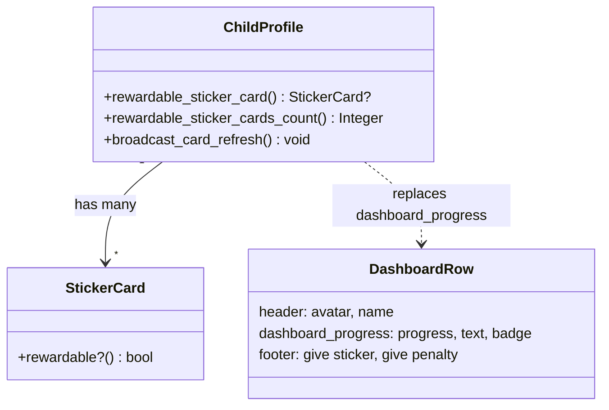
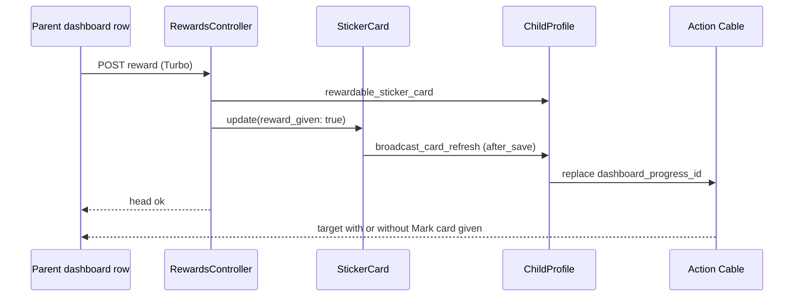

# Plan: Parent dashboard fits three children on an iPhone 12 mini

From `intent.md` (2026-11-04). Status: accepted.

## Design

### Domain terms

No `GLOSSARY.md` exists yet. Terms this plan uses:

- **Dashboard row**: one child's `article#dashboard_row_<id>` on `/parent/children`. It holds the `turbo_stream_from` source, the completion flag and the `confetti` Stimulus controller. It is never replaced over Action Cable.
- **Dashboard progress target**: `div#dashboard_progress_<id>` inside the dashboard row. It is the only part of the row that `ChildProfile#broadcast_card_refresh` replaces. After this change it also holds Mark card given.
- **Card ready to reward**: a sticker card that is `rewardable?` (completed, reward not given).
- **Mark card given**: the button that posts to `parent_child_reward_path(child)`. `Parent::RewardsController#create` marks the oldest card ready to reward as given. Its label is the existing `parent.actions.mark_rewarded` key ("🎁 Mark Rewarded", "🎁 Markeer Beloond", "🎁 Segna premiato").
- **Tab bar**: mvpa's fixed `body > header` nav at phone width (`max-width: 768px`).
- **Safe-area inset**: the strip of the screen that the iPhone status bar or home indicator covers, exposed to CSS as `env(safe-area-inset-*)`.

### Diagrams

Before: the touched objects and the live update of a dashboard row today.

After: the same objects. Only the dashboard progress target gains the Mark card given form.

A sticker that completes a card follows the same path: `StickerCard#broadcast_completion` calls `broadcast_card_refresh`, so the button appears in the row without a reload.

### Signatures

Not affected: no Ruby class or public method changes. All live behaviour runs through the existing `ChildProfile#broadcast_card_refresh #: () -> void`, which already replaces the dashboard progress target on sticker create, card completion, reward given and goal change.

View contract of `app/views/parent/children/_dashboard_progress.html.erb` (local `child`):

- Renders the progress bar and the progress text, as today.
- Reads `ready = child.rewardable_sticker_cards_count` once.
- When `ready.positive?`: renders `p#reward_badge_<id>` with `t("parent.dashboard.rewardable_cards", count: ready)`, then, as a sibling (a form inside a `
` is invalid HTML), `button_to t("parent.actions.mark_rewarded"), parent_child_reward_path(child), method: :post, class: "button-success"`.

Checked by: steep check

### Complexity

- Dashboard request: no new query path. Today the partial calls `rewardable_sticker_card` and then `rewardable_sticker_cards_count`; each walks the preloaded cards and runs two COUNT queries per card (`completed?`). After the change the partial calls only the count, so the row runs fewer queries than today. No numeric claim is made, so no query-count test.
- Broadcast: unchanged — the same three replaces per refresh.
- CSS: no JavaScript, no new Stimulus controller.

### Invariants

- A dashboard row shows Mark card given exactly when the child has at least one card ready to reward. Enforced by the guard in `_dashboard_progress.html.erb`; the page render and every broadcast use that one partial, so they cannot disagree.
- The dashboard row element is never replaced over Action Cable, so the stream source and the confetti controller stay connected. Enforced by `ChildProfile#broadcast_card_refresh`, whose targets stay `card`, `parent_card` and `dashboard_progress`.
- At 375×728 CSS px, every button of three dashboard rows ends above the tab bar's top edge at scroll position 0, with and without Mark card given in every row. Enforced by the CSS in `3_modules/dashboard_row.css`.
- Every tab of the tab bar shares one top edge and lies inside the viewport width, for a parent, an admin and a child. Enforced by `2_layout/app_shell.css` and by the nav holding only links.

### Alternatives

1. **Chosen — button inside the dashboard progress target, compact CSS grid.** No new broadcast, no Ruby change, one partial decides when the button shows. The cost: Mark card given sits on its own line with the badge, not in the footer next to Give sticker and Give penalty, so a row with a ready card is about 3rem taller. The height budget below still fits three such rows.
2. **Rejected — a separate `reward_action` target in the footer, with a fourth replace in `broadcast_card_refresh`.** It puts all three buttons on one line and keeps row heights equal. Rejected because two partials must evaluate the same predicate, the model method grows, and three buttons on one line at about 6.7rem each force short labels ("🎉 Sticker", "🎁 Given") with new copy in three languages.
3. **Rejected — replace the whole dashboard row on refresh.** Simplest markup, but it reconnects the `turbo_stream_from` source and the confetti controller on every sticker, so a completion flag broadcast during the reconnect can be lost.

Height budget per row at 375 px wide (1rem = 16 px):

| Part | No card ready | Card ready |
|---|---|---|
| Border and padding (0.5rem × 2) | 1.125rem | 1.125rem |
| Header: avatar 1.75rem, name one line with ellipsis | 1.75rem | 1.75rem |
| Progress line: bar and text on one line | 1.25rem | 1.25rem |
| Badge and Mark card given on one line | — | 2.75rem |
| Footer: Give sticker and Give penalty, two equal columns | 2.75rem | 2.75rem |
| Margins between parts (0.375rem each) | 0.75rem | 1.125rem |
| **Row** | **7.6rem (122 px)** | **10.75rem (172 px)** |

Three rows with a card ready plus two 0.5rem row margins: 33.25rem (532 px). Page heading at 1.5rem plus main padding: about 3rem (48 px). Total about 580 px against 664 px available (812 − 50 status bar − 34 home indicator − 64 tab bar).

## Design decisions

- Mark card given reuses the existing `parent.actions.mark_rewarded` key and its three translations. The intent names the behaviour "Mark card given"; it does not ask for new copy, and reuse keeps the dashboard and the child page consistent without inventing Dutch and Italian text.
- Give sticker and Give penalty keep their full labels. Two equal columns of about 10rem fit "🎉 Give Sticker", "🎉 Geef Sticker" and "❌ Dai penalita" on one line.
- The badge ("1 card ready to reward!") stays. With two ready cards it tells the parent the button will stay after one tap. It truncates with an ellipsis so it never adds a line.
- The intent's `## Decisions` say: home-screen app, button only when a card is ready, tab bar fixed in this change, Logout to Preferences. Every step below follows them. No conflict.
- Conflict between domain guidance and the intent: the `rails-ui` skill says CSS useful to more than one app belongs upstream in mvpa.css. The safe-area inset and the tab bar fixes are generic. The intent's constraint "this app does not change the gems" wins for this change; the upstream move is a follow-up (see Risks).

## Integration points

- `mvpa.css` gem: `1_layout/0_header.css` (fixed `body > header`, `--nav-height-mobile`), `2_modules/10_navigation.css` (tab styles), `1_layout/2_footer.css` (global `footer` margin and border), `2_modules/1_forms.css` (`form + form` margin), `2_modules/8_article.css`. This app overrides them with higher-specificity selectors loaded after mvpa (`application.css` imports mvpa first).
- `appkit` gem: the app already shadows `appkit/shared/_nav.html.erb` and `appkit/preferences/edit.html.erb`. `session_path` with `method: :delete` logs out (appkit `SessionsController#destroy`).
- Action Cable / Turbo Streams: unchanged targets. A `button_to` rendered in a broadcast carries a renderer CSRF token; Turbo sends the page's `X-CSRF-Token` header, and the child page already relies on this for the same button.

## Files that change

- `app/views/parent/children/_dashboard_progress.html.erb` — read the count once; render the badge and Mark card given when it is positive.
- `app/views/parent/children/index.html.erb` — no structural change expected; touch only if the CSS needs a hook. The `<footer>` keeps its two forms.
- `app/assets/stylesheets/3_modules/dashboard_row.css` (new) — compact dashboard row, scoped to `main article[data-controller="confetti"]`. The article stays in normal block flow, not grid or flex: its non-visual children (`turbo-cable-stream-source`, the empty completion-flag ``) then sit in zero-height line boxes and add no space, so no wrapper element is needed. Spacing comes from explicit margins. Every inherited mvpa value the budget depends on is reset:
  - article: `padding: 0.5rem 0.75rem; margin-block-end: 0.5rem` (mvpa: 1rem padding and margin).
  - header: `display: flex; align-items: center; gap: 0.5rem; margin: 0`; avatar `inline-size: 1.75rem; block-size: 1.75rem`; the name link `flex: 1; min-inline-size: 0`; `h2`: `margin: 0; font-size: var(--text-medium); line-height: 1.75rem; white-space: nowrap; overflow: hidden; text-overflow: ellipsis`.
  - dashboard progress target: `margin-block-start: 0.375rem`; inside it a flex line for `progress` (`flex: 1; block-size: 0.75rem; margin: 0`) and the progress `p` (`margin: 0; font-size: var(--text-small); line-height: 1.25rem; white-space: nowrap`); the badge `p` and the reward form share a second flex line (`margin-block-start: 0.375rem`; badge `flex: 1; min-inline-size: 0; margin: 0; overflow: hidden; text-overflow: ellipsis; white-space: nowrap`).
  - footer: `display: grid; grid-template-columns: repeat(2, minmax(0, 1fr)); gap: 0.375rem; margin: 0.375rem 0 0; padding: 0; border: 0; max-inline-size: none` (cancels mvpa's global footer rule).
  - forms in the row: `margin: 0; max-inline-size: none` (cancels `form + form`).
  - buttons in the row: `margin: 0; inline-size: 100%; min-block-size: 2.75rem; white-space: nowrap`.
  - page `h1`: `font-size: var(--text-large); margin-block: 0 0.5rem` via `main > section:has(> article[data-controller="confetti"]) > header h1`.
  The implementer reads mvpa's `2_typography.css`, `6_progress.css`, `8_article.css`, `1_forms.css` and `5_buttons.css` first and resets any further margin or padding they set on these elements. The fit system tests measure the computed layout, so a missed reset fails a test.
- `app/assets/stylesheets/3_modules/index.css` — import `dashboard_row.css`.
- `app/assets/stylesheets/2_layout/child_cards.css` — remove the `article[data-controller="confetti"]` rules that the new module replaces (footer flex, padding-inline, footer link min-height). The child dashboard rules (`[data-controller="confetti"] > article`) and the history rule stay.
- `app/assets/stylesheets/2_layout/app_shell.css` (new) — safe-area and tab bar, inside `@media (max-width: 768px)`: `:root { --tab-bar-height: 4rem; --nav-height-mobile: calc(var(--tab-bar-height) + env(safe-area-inset-bottom, 0rem)); }`; `body { padding-block-start: env(safe-area-inset-top, 0rem); }`; `body > header { padding-block-end: env(safe-area-inset-bottom, 0rem); }`; `body > header nav { block-size: var(--tab-bar-height); min-block-size: 0; }`; `body > header nav > ul > li { min-inline-size: 0; }` (mvpa sets `header nav > ul > li { min-inline-size: max-content }`, so the selector must be more specific); `body > header nav > ul > li > a { block-size: calc(var(--tab-bar-height) - var(--block-space)); overflow: hidden; text-overflow: ellipsis; white-space: nowrap; }`. Every override uses a selector more specific than mvpa's rule and loads after it.
- `app/assets/stylesheets/2_layout/index.css` — import `app_shell.css`.
- `app/views/layouts/parent.html.erb`, `app/views/layouts/child.html.erb` — viewport meta becomes `width=device-width,initial-scale=1,viewport-fit=cover`.
- `app/views/appkit/shared/_nav.html.erb` — remove the Logout `<li>`.
- `app/views/appkit/preferences/edit.html.erb` — add `button_to t("appkit.navigation.logout"), session_path, method: :delete` after the preferences form, outside it.
- `test/system/parent_dashboard_fit_test.rb` (new) — the fit, tab bar and live tests below.
- `test/integration/parent/children_dashboard_layout_test.rb` — the test at line 20 asserts the reward form is absent on the dashboard; it changes to assert the form is present for a child with a ready card and absent for one without.
- `test/controllers/navigation_test.rb` — line 110 asserts `nav button` "Uitloggen"; it changes to assert the nav has no button.
- `test/integration/preferences_test.rb` — new tests: Preferences shows Log out; logging out from there lands on the sign-in page.
- `test/models/child_profile_test.rb` — new broadcast tests (below). Add `include Turbo::Broadcastable::TestHelper` (and its require, as `test/models/sticker_card_test.rb` does) for `capture_turbo_stream_broadcasts`.
- `test/integration/layout_meta_test.rb` (new) — the parent layout and the child layout both render `viewport-fit=cover` in the viewport meta.

## Order of work

1. Write `test/system/parent_dashboard_fit_test.rb` "three children with a card ready each fit above the tab bar on an iPhone 12 mini" (CDP `Emulation.setDeviceMetricsOverride` to 375×728, mobile, scale 3; fixtures `child_profiles(:one, :two, :three)` each given enough stickers to complete a card). Run it and watch it fail: the third row's buttons end below the tab bar, and no row has Mark card given. This is the regression test of the bug fix.
2. Change `test/integration/parent/children_dashboard_layout_test.rb:20` to the reversed assertion. Run it, watch it fail.
3. Render the badge and Mark card given in `_dashboard_progress.html.erb`. Run tests 2 and the existing `parent_ui_test.rb` badge tests; they pass. Test 1 still fails on height.
4. Add the broadcast tests to `test/models/child_profile_test.rb`; they pass with step 3.
5. Add `3_modules/dashboard_row.css`, import it, remove the replaced rules from `child_cards.css`. Run test 1; it passes. Add the "no card ready" fit test and the long-name and Dutch variant; they pass.
6. Write the live tests (a card completes while the dashboard is open; a tap removes the button; two ready cards keep it). Run them; fix until green.
7. Write the tab bar system test (parent, admin, child) and change `navigation_test.rb:110`. Watch them fail on the Logout button.
8. Remove Logout from `_nav.html.erb`, add it to `preferences/edit.html.erb`, add the preferences tests. Run them; they pass.
9. Write `test/integration/layout_meta_test.rb`; watch it fail. Add `viewport-fit=cover` to both layouts, `2_layout/app_shell.css` and its import. Run the tab bar tests and the fit tests again.
10. Run the full suite: `bin/rails test`, `bin/rails test:system`. Run `bin/rubocop`, `bin/erb_lint --lint-all --allow-no-files`, `npx @herb-tools/linter`, `bundle exec ruby ./bin/check_i18n_normalized`, `bin/brakeman`, `bin/bundler-audit` if present, `steep check` (generate `sig/` first: `bin/rbs --collection=rbs_collection.yml collection install --frozen && bin/rails db:prepare rbs_rails:all`).
11. Take screenshots at 375×728 of the dashboard (0 and 3 ready cards, en and nl), a child page and Preferences, and record them as evidence.

## Risks

- Headless Chrome reports `env(safe-area-inset-*)` as 0, so no automated test proves the home-indicator clearance. The fit test emulates the conservative 728 px height instead; the real inset needs a check on the iPhone 12 mini home-screen app. If Chrome supports CDP `Emulation.setSafeAreaInsetsOverride`, use it in the tab bar test; otherwise skip that part and say so in the evidence.
- `viewport-fit=cover` with the default status-bar style may still extend content under the status bar on some iOS versions. The `padding-block-start: env(safe-area-inset-top)` on `body` guards it.
- Overriding `--nav-height-mobile` changes mvpa's body bottom padding and the subnavigation popup offset too. That is the intent (both must clear the inset), but the admin popup must be checked by eye.
- `:has()` needs iOS 15.4 or later; the iPhone 12 mini runs current iOS. The `h1` size is cosmetic, so an older browser only loses headroom.
- A long Dutch or Italian badge truncates with an ellipsis. Accepted: the count digit comes first.
- Turbo disables the submitter during a request, but a fast double tap on Mark card given with two ready cards could still give both. Same as the child page today; not addressed here.
- The CSS scopes on `data-controller="confetti"`, a JavaScript hook. `child_cards.css` already does this; changing it is out of scope.
- Follow-up, not in this change: move the safe-area inset and the tab bar fixes upstream into mvpa.css, and remove them here after.
- Out of scope, per `intent.md`: the child dashboard (apart from its tab bar), a fourth child, the child page, history and settings pages, allowances, undo, notes and emoji choice. The "Enable reminders" fieldset stays below the fold.

## Proof

- Three children, none with a card ready: all names, progress, Give sticker and Give penalty visible without scrolling → `test/system/parent_dashboard_fit_test.rb` `test "three children with no card ready fit above the tab bar on an iPhone 12 mini"`
- Three children, each with a card ready: Mark card given visible for each, all three rows fit → `test/system/parent_dashboard_fit_test.rb` `test "three children with a card ready each fit above the tab bar on an iPhone 12 mini"`
- Charlie has a card ready, Bob has none: only Charlie's row shows Mark card given → `test/integration/parent/children_dashboard_layout_test.rb` `test "dashboard shows mark rewarded only in the row of a child with a card ready to reward"`
- Tapping Mark card given for Charlie marks the oldest ready card given, and the button disappears when none is left → `test/system/parent_dashboard_fit_test.rb` `test "mark rewarded on the dashboard gives the card and removes the button"`
- Two cards ready: one tap gives the oldest, the button stays → `test/system/parent_dashboard_fit_test.rb` `test "mark rewarded stays on the dashboard while a second card is ready"`
- Bob's card completes while the dashboard is open: the button appears without a reload, rows still fit → `test/system/parent_dashboard_fit_test.rb` `test "mark rewarded appears live when a card completes and the rows still fit"`
- Every tab whole, aligned and inside the viewport for a parent, an admin and a child → `test/system/parent_dashboard_fit_test.rb` `test "tab bar tabs share one row inside the viewport for parent, admin and child"`; above the home indicator → `test/integration/layout_meta_test.rb` `test "parent layout lets the page reach the safe area"` and `test "child layout lets the page reach the safe area"` plus check: open the home-screen app on an iPhone 12 mini and see the tab bar above the home indicator
- No Logout in the tab bar; Preferences → Log out lands on the sign-in page → `test/controllers/navigation_test.rb` `test "the Dutch nav shows appkit's wording"` (no `nav button`), `test/integration/preferences_test.rb` `test "preferences page offers log out"` and `test "logging out from preferences lands on the sign-in page"`
- Invariant: a row shows Mark card given exactly when a card is ready, enforced by the guard in `_dashboard_progress.html.erb` → `test/models/child_profile_test.rb` `test "broadcast_card_refresh sends the dashboard progress with mark rewarded when a card is ready"` and `test "broadcast_card_refresh sends the dashboard progress without mark rewarded when no card is ready"`
- Invariant: the dashboard row is never replaced, enforced by `ChildProfile#broadcast_card_refresh` → `test/models/child_profile_test.rb` `test "broadcast_card_refresh never replaces the dashboard row"`
- Invariant: buttons of three rows end above the tab bar at 375×728, enforced by `3_modules/dashboard_row.css` → the two fit tests above, plus `test "long names and Dutch labels still fit above the tab bar"`

Per changed file, the unit tests expected:

- `app/models/child_profile.rb` (behaviour unchanged, broadcast content changes through the partial): `ChildProfile#broadcast_card_refresh sends mark rewarded when a card is ready`, `sends no mark rewarded when no card is ready`, `never replaces the dashboard row`.
- `app/views/parent/children/_dashboard_progress.html.erb`: covered by the integration and model tests above.
- `app/views/appkit/shared/_nav.html.erb`, `app/views/appkit/preferences/edit.html.erb`: covered by `navigation_test.rb` and `preferences_test.rb`.
- CSS: covered by the system tests.
- Layouts: covered by `test/integration/layout_meta_test.rb`.

Test setup: fixtures `users(:parent)`, `users(:admin)`, `child_profiles(:one, :two, :three)` (Alice, Bob, Charlie; `:two` already has `completed_unrewarded`). A test makes a card ready by creating `required_stickers` positive stickers on the active card. The long-name variant renames the three users to 30-character names and signs in a parent with `locale: "nl"`. The system tests set the viewport with `page.driver.browser.execute_cdp("Emulation.setDeviceMetricsOverride", width: 375, height: 728, deviceScaleFactor: 3, mobile: true)` and measure with `getBoundingClientRect` against `body > header`. Live tests use `using_session` and the existing `connect_turbo_cable_stream_sources` helper, as `realtime_sticker_test.rb` does. Broadcast tests use turbo-rails' `capture_turbo_stream_broadcasts`.

---
Domain skills applied: software-design, rails-ui, diagrams, glossary (no file yet), rails-testing conventions (Minitest, fixtures).

## Critique

### Round 1 (codex exec -p terra)

- A bare `li { min-inline-size: 0 }` loses to mvpa's `header nav > ul > li { min-inline-size: max-content }` → fixed (app_shell.css now uses `body > header nav > ul > li` and scopes the ellipsis to its link)
- The height budget ignores inherited mvpa margins and sizes on article, h2, p, progress and buttons → fixed (dashboard_row.css lists explicit resets for each, and the implementer reads the named mvpa files first; the fit tests measure computed layout)
- A grid on the article turns the stream source and the completion-flag span into grid items that add gaps → fixed (the article stays in block flow with explicit margins; empty inline children collapse to zero-height line boxes, so no wrapper element is needed)
- The viewport-meta proof has no test file and cannot cover the child layout → fixed (new `test/integration/layout_meta_test.rb` with one test per layout, listed in Files that change and Proof)
- `child_profile_test.rb` lacks the Turbo broadcast test helper → fixed (Files that change now adds the require and `include Turbo::Broadcastable::TestHelper`)
- The Herb command is wrong and the RBS step points at an absent CLAUDE.md → fixed (command is now `npx @herb-tools/linter`; the RBS generation command is written out in step 10, though CLAUDE.md does exist in the worktree)

Reproduction: committed
