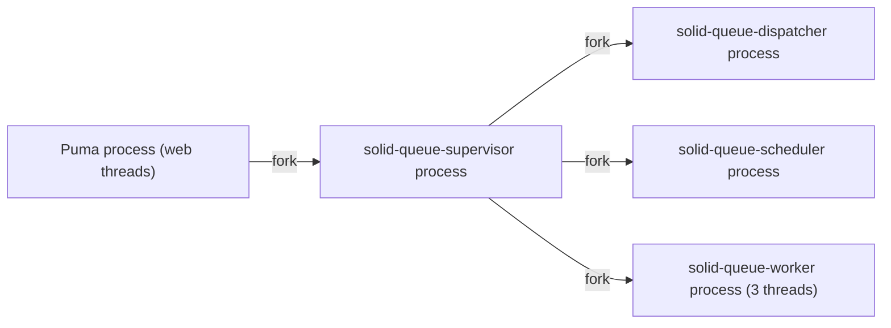
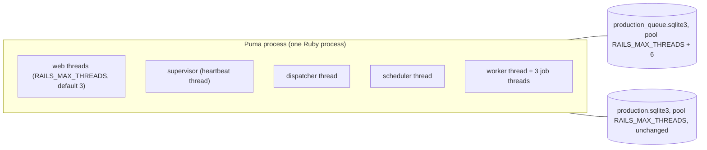

# Plan: Run Solid Queue in async mode inside Puma

From `intent.md` (2026-10-26). Status: accepted.

## Design

### Domain terms

- Fork mode: Solid Queue's default. The supervisor forks one Ruby process each for the dispatcher, the scheduler and every worker.
- Async mode: the supervisor runs the dispatcher, the scheduler and the worker as threads inside the host process. Here the host is Puma.
- Puma plugin: `plugin :solid_queue` in `config/puma.rb`. It starts the supervisor after Puma boots. `solid_queue_mode` picks fork or async.
- Queue pool: the Active Record connection pool of the production `queue` database.

No glossary file exists in this repository, and these are infrastructure terms, not domain terms. No glossary change.

### Diagrams

Before (fork mode, production with `SOLID_QUEUE_IN_PUMA=true`):



After (async mode):



### Signatures

Not affected: the change touches no Ruby class or method. It adds one Puma DSL call (`solid_queue_mode :async`, defined by `lib/puma/plugin/solid_queue.rb` in the solid_queue gem) and one ERB expression in YAML.

Not checked: no Ruby signatures change, so there is nothing for Steep to check.

### Complexity

- No new request path. Requests run no extra queries.
- Memory: the supervisor, dispatcher and scheduler processes (about 160 MB private memory, measured in Fizzy) disappear. The worker process disappears too; its threads move into Puma.
- CPU: job threads now share Puma's GVL. At 2 to 5 users this has no visible effect.
- Queue database connections, in one process (counted in the solid_queue 1.3.1 source; re-check in 1.7.0, step 1):
  - Held for a whole job or request: up to P Puma threads that enqueue (P = Puma threads, 3 in production) and 3 job threads (`Pool#post` wraps `ClaimedExecution#perform` in the app executor).
  - Held for milliseconds: the worker poller (every 0.1 s), the dispatcher poller (every 1 s), and recurring enqueue (one `Concurrent::ScheduledTask` per recurring task; today's three tasks fire at different minutes, but nothing forces that).
  - Held for milliseconds, rarely: one heartbeat timer per Solid Queue process (supervisor, dispatcher, worker, scheduler; every 60 s), dispatcher concurrency maintenance (every 600 s), supervisor maintenance (every 5 min), and thread replacement (only after a thread dies).
  - These timers can overlap, so this list is a count of holders, not a guaranteed ceiling. Long holders: P + 3. The pool of `RAILS_MAX_THREADS + 6` (11 at defaults, with P = 3) leaves 5 slots for the short holders. A thread that finds the pool full waits up to `checkout_timeout` (5 s); short holders return their connection within milliseconds. Pool exhaustion is therefore unlikely and is an accepted risk (see Risks).
  - `JOB_CONCURRENCY` does not grow the count: in async mode `SolidQueue::Configuration#workers` builds one worker per `queue.yml` entry and ignores `processes`.

### Invariants

- Production starts no Solid Queue child process. Enforced by `solid_queue_mode :async` in `config/puma.rb`. In async mode with `standalone: false`, the supervisor and its threads never fork and never set `$0`.
- The queue pool is at least `RAILS_MAX_THREADS + 6`. Enforced by the ERB expression on the production `queue:` entry in `config/database.yml`. A non-integer `RAILS_MAX_THREADS` fails boot, enforced by `Integer(...)`.
- Development and test boot exactly as before when `SOLID_QUEUE_IN_PUMA` is unset. Enforced by guarding `solid_queue_mode` with the same condition as `plugin :solid_queue`. `Puma::DSL#solid_queue_mode` exists only after the plugin file loads, so an unguarded call raises `NoMethodError` when the plugin is not loaded.

### Alternatives

1. Chosen: one guarded `solid_queue_mode :async if ENV["SOLID_QUEUE_IN_PUMA"]` line directly after the plugin line, and `pool: <%= Integer(ENV.fetch("RAILS_MAX_THREADS", 5)) + 6 %>` on the production `queue:` entry only.
2. Rejected: an `if ENV["SOLID_QUEUE_IN_PUMA"] … end` block around both plugin lines. It is equally correct, but it rewrites the existing plugin line and makes the diff larger for no gain.
3. Rejected: `SOLID_QUEUE_SUPERVISOR_MODE=async` in `config/deploy.yml`. The Puma plugin ignores that variable (it passes `mode:` itself), and `deploy.yml` is out of scope.
4. Rejected: a fixed `pool: 11`. `intent.md` decides on a formula that follows `RAILS_MAX_THREADS`.
5. Rejected: a pool of `RAILS_MAX_THREADS + worker threads read from config/queue.yml + 10` (18 at defaults), which counts every holder and follows `queue.yml`. It makes `database.yml` read `queue.yml` at boot and copy two gem rules into it. It also changes the agreed `RAILS_MAX_THREADS + 6` decision, which auto mode may not do.

## Design decisions

- `solid_queue_mode :async` carries the same `if ENV["SOLID_QUEUE_IN_PUMA"]` guard as the plugin line. Without the guard, `bin/dev` and the test suite, which run without that variable, would fail at Puma boot with `NoMethodError`. This keeps the intent's "on the line after `plugin :solid_queue`" and adds only the guard.
- The formula reuses the `RAILS_MAX_THREADS` default of 5 that `database.yml` already uses, not Puma's default of 3. With defaults it resolves to 11, as the acceptance criterion asks, and leaves 2 spare connections in production, where Puma runs 3 threads.
- `Integer(...)` converts the env string before the addition, so `RAILS_MAX_THREADS=10` gives 16, not a `TypeError`. `Integer` raises on a bad value such as `abc`; `.to_i` would turn it into 0 and a pool of 6 without a word.
- The formula keeps the intent's `+ 6`. The intent's reasoning names 6 holders; the code has more short-lived ones (see Complexity). They release within milliseconds and the 5 s checkout wait covers them, so `+ 6` stays, as agreed.
- No conflict with `intent.md`'s `## Decisions`.

## Integration points

- Puma 7 plugin API: the solid_queue plugin hooks `after_booted`, `after_stopped` and `before_restart`. In async mode it calls `SolidQueue::Supervisor.start(mode: :async, standalone: false)` inside the Puma process.
- `config/queue.yml`: one dispatcher, one worker with 3 threads. `processes` is ignored in async mode. Unchanged.
- `config/recurring.yml`: the production section with `clear_solid_queue_finished_jobs`, `appkit_session_expiry` (`Appkit::SessionExpiryJob`) and `allowance_period_granting` (`AllowancePeriodGrantingJob`). Unchanged; the scheduler thread loads it.
- `config/deploy.yml` sets `SOLID_QUEUE_IN_PUMA: true` and no `RAILS_MAX_THREADS`. Unchanged and out of scope.

## Files that change

- `config/puma.rb` — add `solid_queue_mode :async if ENV["SOLID_QUEUE_IN_PUMA"]` on the line after `plugin :solid_queue if ENV["SOLID_QUEUE_IN_PUMA"]`. Change the comment above the plugin line to say the supervisor runs in async mode, as threads inside Puma, to save memory.
- `config/database.yml` — in `production.queue`, add `pool: <%= Integer(ENV.fetch("RAILS_MAX_THREADS", 5)) + 6 %>` after `<<: *default`. A key after the merge key overrides the merged `pool`. Add a one-line comment that says what the extra 6 connections cover.

Nothing else changes. `docs/changes/solid-queue-async-mode/verification.md` records the evidence (see step 6); it is a change artifact and `deliver` removes it with the folder.

## Order of work

No acceptance criterion needs an automated test: both changes are configuration (playbook rule 3). Each criterion has a check instead, run after the change.

1. Prepare the worktree. Run `bundle check`. If it fails (solid_queue 1.7.0 and the git-sourced `rubocop-eirvandelden` are not installed in this environment), run `bi`. `bi` installs only the locked set in `Gemfile.lock`; it adds no dependency. Do not run `bundle install` or `bundle update`. If `bi` fails, stop and report it (playbook rule 8). Then confirm the 1.7.0 source still matches this plan: `grep -n "solid_queue_mode\|standalone: false" "$(bundle show solid_queue)/lib/puma/plugin/solid_queue.rb"` shows `def solid_queue_mode` and `start_solid_queue(mode: :async, standalone: false)`. If it does not, stop and report the difference.
2. Edit `config/puma.rb` as described in "Files that change". Commit: `Run Solid Queue in async mode inside Puma`.
3. Edit `config/database.yml` as described in "Files that change". Commit: `Size the production queue pool for async Solid Queue`.
4. Run the pool check (Proof line 5).
5. Start a production-like server and run the process, job, recurring and `/up` checks (Proof lines 1 to 4). Setup, from the worktree root, in one shell:

   ```sh
   export RAILS_ENV=production SECRET_KEY_BASE_DUMMY=1 SOLID_QUEUE_IN_PUMA=true PORT=3999
   bin/rails db:prepare
   bin/rails server > tmp/async-mode-server.log 2>&1 &
   PUMA_PID=$!
   ```

   Wait until the log shows `Listening on`. `bin/rails server` runs Puma in the same process, so `$!` is the Puma pid; confirm with `ps -o command= -p "$PUMA_PID"`, which shows `puma`. `SECRET_KEY_BASE_DUMMY=1` avoids the master key; the app reads no credentials. `config.assume_ssl` keeps `force_ssl` from redirecting `/up`. Never print `.env` or credential files. When done, stop the server with `kill -INT "$PUMA_PID"`, check the log shows a clean Solid Queue stop, and delete `storage/production*.sqlite3*` and `tmp/async-mode-server.log` (all gitignored).
6. Write `docs/changes/solid-queue-async-mode/verification.md` with each command and its output. Commit: `Verification for solid-queue-async-mode`.
7. Run the full test suite and every linter (Proof line 6). Fix what fails.
8. Re-read the diff against `main`. Every hunk must belong to this plan.

## Risks

- An unguarded `solid_queue_mode` breaks every Puma boot without `SOLID_QUEUE_IN_PUMA`. Mitigated by the guard; the full test suite and a plain `bin/rails server` boot in development prove it.
- A slow or stuck job now shares the Puma process. A crash in a job thread is rescued by Solid Queue; a memory leak in a job now grows the web process. Accepted in `intent.md` for the memory gain.
- In fork mode the plugin stopped Puma when Solid Queue died. In async mode no such monitor exists; a dead supervisor thread leaves Puma serving without jobs. Solid Queue's supervisor restarts dead threads it supervises, so the residual risk is the supervisor itself. Accepted; at this user count Etienne notices through the missing daily jobs.
- Pool exhaustion on the queue database raises `ActiveRecord::ConnectionTimeoutError`. Accepted risk: the `RAILS_MAX_THREADS + 6` pool and the 5 s checkout wait make it unlikely, but overlapping timers can exceed it (see Complexity).
- The primary pool stays at 5 (out of scope). Async mode puts 3 job threads next to 3 Puma threads in one process, so 6 threads can want a primary connection. A job that touches primary for more than 5 s while all Puma threads use primary can raise `ConnectionTimeoutError`. Today's jobs are short. Raised as a `Decision needed:` line, not changed.
- The gem's own boot check (`SolidQueue::Configuration#ensure_correctly_sized_thread_pool`, pool ≥ worker threads + 2) aborts Puma if the queue pool is far too small. 11 passes it.
- The change does not deploy. Production keeps fork mode until Etienne deploys.

## Proof

- With `SOLID_QUEUE_IN_PUMA=true` and production-like settings, `ps` shows one Ruby process for Puma and no solid-queue process → check: with the server from step 5 running, in the same shell: `ps -o pid,command -p "$PUMA_PID"` shows one `puma` line; `pgrep -P "$PUMA_PID" || echo "no child processes"` prints `no child processes` (pgrep exits 1 when it finds none); `ps -axo command | grep -c '[s]olid-queue-'` prints `0`.
- An enqueued job runs to completion → check: `bin/rails runner 'job = AllowancePeriodGrantingJob.perform_later; 20.times { break if SolidQueue::Job.find_by(active_job_id: job.job_id)&.finished_at; sleep 0.5 }; p SolidQueue::Job.find_by(active_job_id: job.job_id).finished_at'` prints a timestamp, not `nil`. Same environment as step 5.
- The scheduler loads every task in `config/recurring.yml` → check: `bin/rails runner 'p SolidQueue::RecurringTask.order(:key).pluck(:key, :class_name)'` lists `allowance_period_granting` with `AllowancePeriodGrantingJob`, `appkit_session_expiry` with `Appkit::SessionExpiryJob`, and `clear_solid_queue_finished_jobs`. Also `bin/rails runner 'p SolidQueue::Process.order(:kind).pluck(:kind)'` prints `["Dispatcher", "Scheduler", "Supervisor", "Worker"]`, and `bin/rails runner "p SolidQueue::Process.distinct.pluck(:pid) == [$PUMA_PID]"` prints `true`. Same shell and environment as step 5.
- `/up` returns 200 → check: `curl -s -o /dev/null -w '%{http_code}\n' http://localhost:3999/up` prints `200`.
- The queue pool in production resolves to at least 11 with default settings → check: `env -u RAILS_MAX_THREADS RAILS_ENV=production SECRET_KEY_BASE_DUMMY=1 bin/rails runner 'p %w[primary cache queue cable].to_h { |name| [name, ActiveRecord::Base.configurations.configs_for(env_name: "production", name: name).pool] }'` prints `{"primary" => 5, "cache" => 5, "queue" => 11, "cable" => 5}`. The same command with `RAILS_MAX_THREADS=10` instead of `env -u RAILS_MAX_THREADS` prints `{"primary" => 10, "cache" => 10, "queue" => 16, "cable" => 10}`.
- The full test suite and every linter are green → check: `bin/rails test`, `bin/rails test:system`, `bin/rubocop`, `bin/brakeman`, `bin/bundle-audit check --update`, `bin/importmap audit`, `bin/erb_lint --lint-all --allow-no-files`, `npm ci` then `npx @herb-tools/linter` (the locked package CI runs), `bundle exec ruby ./bin/check_i18n_normalized`. Each exits 0.
- Invariant: development boots without `SOLID_QUEUE_IN_PUMA`, enforced by the guard in `config/puma.rb` → check: `env -u SOLID_QUEUE_IN_PUMA bin/rails server -p 3998` reaches `Listening on`, then stop it.

Per changed file, the unit tests expected: none. Both files are configuration; playbook rule 3 exempts configuration from tests.

Test setup: none. The checks run against a local production-like server with `SECRET_KEY_BASE_DUMMY=1` and throwaway SQLite files in `storage/`.

Out of scope: `config/deploy.yml` and `SOLID_QUEUE_IN_PUMA`; the primary, cache and cable pools; `config/queue.yml`; deploying; the untracked `yarn.lock` and modified `db/schema.rb` in the main checkout.

---
Domain skills applied: rails-architecture (config-only, no domain logic), dependencies (no gem change; `bi` only installs the locked set), rails-ops (single-process deployment trade-off).

## Critique

### Round 1 (codex exec -p terra)

- Step 1 assumes the locked bundle can be installed, `bi` was not on the critic's PATH, and `gem contents` only lists files → fixed (step 1 now inspects the 1.7.0 plugin with `bundle show solid_queue` and grep, and stops on a failed `bi`)
  - `bi` stays: it is on Etienne's PATH (`~/.local/bin/bi`), playbook rule 11 names it, and it installs only the locked set, so it adds no dependency and does not break intent's "no gems" constraint.
- "Strict ceiling: P + 13" is not strict, because heartbeat and maintenance timers and one ScheduledTask per recurring task can overlap → fixed (Complexity calls the list a count of holders, Risks calls pool exhaustion an accepted risk, and the queue-pool Decision needed claim is removed; `+ 6` stays as agreed)
- The `ps` proof matches every Ruby process on the machine, never captures the Puma pid, and `pgrep -P` exits 1 with no children → fixed (step 5 captures `PUMA_PID=$!`; Proof checks that pid, handles an empty pgrep, and compares every `SolidQueue::Process` pid with it)
- The linter proof runs `@herb-tools/herb-lint` instead of the locked `@herb-tools/linter`, and makes bundle-audit conditional → fixed (Proof runs `npm ci` then `npx @herb-tools/linter`, and `bin/bundle-audit check --update` unconditionally)
- The pool proof prints only the queue pool but claims primary, cache and cable stay at 5 → fixed (Proof prints all four pools, with and without `RAILS_MAX_THREADS=10`)
