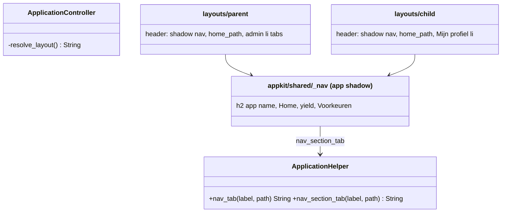
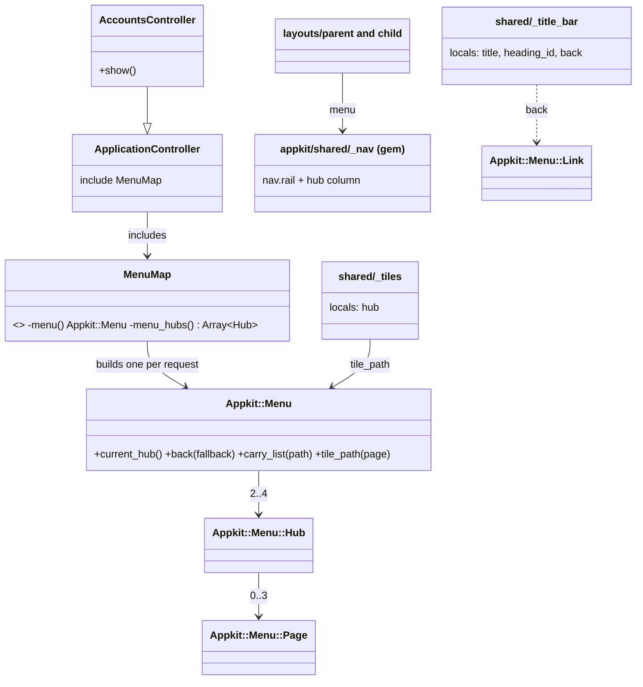
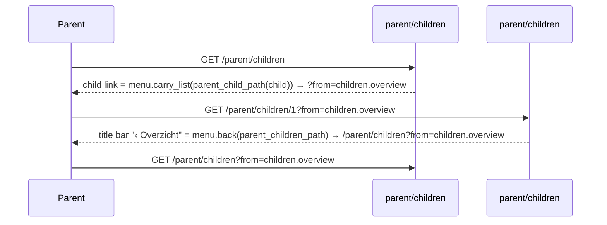

# Plan: Update appkit and mvpa.css to their latest versions

Author: Etienne van Delden. Status: accepted (2026-11-25). Type: feature. Delivery: autonomous.

From `intent.md` (2026-11-24).

## Design

### Domain terms

The repository has no `GLOSSARY.md`, so no avoided word applies. The terms below are appkit's (`Appkit::Menu`) unless marked new.

- **Hub**: one task area. It is a rail item with an emoji, a landing page and pages (`Appkit::Menu::Hub`).
- **Page**: one list of a hub that opens with GET, or a submit page (`Appkit::Menu::Page`).
- **Submit page**: a page whose tile or hub-column item sends a non-GET request. Here only Uitloggen (`verb: :delete`).
- **Rail**: the `nav.rail` list of hubs. On a phone it is the tab bar.
- **Hub column**: the second `nav` with the pages of the current hub. It shows only on 1024px and wider, and only when the current hub has pages.
- **Landing page**: the request that is a hub's own page (`landing:`).
- **Tile**: a landing-page link to one page of the hub, rendered with `menu_entry_to menu.tile_path(page), page`.
- **Origin**: the `from=<hub>` or `from=<hub>.<page>` query value. A record reads it to find its way back.
- **Back link**: the title-bar link built from `menu.back(fallback)`.
- **Menu map** (new): the ordered hubs and pages of one role, built once per request for the signed-in user.
- **Account hub** (new): the 👤 rail hub that every role gets. It holds Voorkeuren, Profiel and Uitloggen.

### Diagrams

Before (current branch):



After:



The back flow from the Kinderen list:



The menu map. Hubs are listed in rail order. Labels come from i18n.

| Hub key | Emoji | Label key | `path` | `landing` | Pages: key → path, controllers | Roles |
|---|---|---|---|---|---|---|
| `:children` | 👨‍👧 | `menu.hubs.children` | `parent_children_path` | `{ "controller" => "parent/children", "action" => "index" }` | `:overview` (`menu.pages.overview`) → `parent_children_path`, the `parent/*` controllers that render a page except `parent/settings`: `parent/children`, `parent/stickers`, `parent/penalties`, `parent/rewards`, `parent/child_profiles`, `parent/children_avatar`, `parent/sticker_card_goals`, `parent/allowances`, `parent/allowance_payments` | parent, admin |
| `:settings` | ⚙️ | `menu.hubs.settings` | `parent_settings_path` | `{ "controller" => "parent/settings" }` | `:child_settings` (`menu.pages.child_settings`) → `parent_settings_path`, `["parent/settings"]` | parent, admin |
| `:admin` | 🛠️ | `menu.hubs.admin` | `admin_root_path` | `{ "controller" => "admin/dashboard" }` | `:users` (`admin.nav.users`) → `admin_users_path`, `["admin/users"]` | admin only |
| `:dashboard` | 🏠 | `menu.hubs.dashboard` | `child_dashboard_path` | `{ "controller" => "child/dashboard" }` | none, so a child gets no hub column | child |
| `:account` | 👤 | `menu.hubs.account` | `account_path` | `{ "controller" => "accounts" }` | `:preferences` (`appkit.navigation.preferences`) → `edit_preferences_path`, `["appkit/preferences"]`; `:profile` (`menu.pages.profile`) → `user_profile_path(Current.user)`, `["users/profiles"]`; last `:sign_out` (`appkit.navigation.logout`) → `session_path`, `[]`, `verb: :delete` | every role, last |

No page has a `count:` or `summary:` lambda.

Where tiles, carry links and back links go:

- Tiles (`shared/_tiles`, a `<nav aria-label=hub label><ul>` with one `<li>` per page): `accounts/show` (Voorkeuren, Profiel, Uitloggen) and `admin/dashboard/index` (Gebruikers). Kinderen, Instellingen and Dashboard land on their own list, which is their only page, so they get no tiles.
- `menu.carry_list`: the child link in `parent/children/index`, the child links in `parent/settings/index`, the View and Edit links in `admin/users/index`.
- Back link (a `back:` local of `shared/_title_bar`, rendered first in its `nav` as `link_to "‹ #{back.label}", back.path`). On a record page that had a hard-coded back link, the page passes `back: record_back_link(fallback)`: `parent/children/show` and `parent/children/edit` (fallback `parent_children_path`) and `admin/users/show` (fallback `admin_users_path`). `record_back_link` is never nil. At appkit `42e22b3`, `menu.back(fallback)` ignores the fallback on a request without `id`, and a failed nested save renders `parent/children/edit` from a route with only `child_id` (`child_profiles#update`, `children_avatar#update`, `allowances#create`). `admin/users/index` and `users/profiles/show` pass `back: menu.back`: it shows "‹ Beheer" or "‹ Account" only when they were opened from a hub, and is nil otherwise. The user list also shows "‹ Beheer" after a round trip through a user, because the record back link and the save redirect return to `/admin/users?from=admin.users`.
- `parent/stickers/index` (history) keeps its own back link. Its route has no `id`, so `Appkit::Menu` treats it as a list, and `back` is nil without an origin.

The origin flow (appkit Upgrading step 9). Every link, form and redirect that stays on the record carries the origin, so the back link survives a save, a failed save and a cancel:

- Forms: `shared/_action_row` renders `hidden_field_tag :from, menu.origin_key` when `menu.origin_key` is present. Every form in these record flows (child edit, card goal, admin user, profile) ends in that partial, so all of them carry it. `shared/_delete_form` (the allowance Turn off) does the same.
- Redirects back to the record use `menu.carry(path)`: `Parent::ChildrenController#update`, `Parent::ChildProfilesController#update`, `Parent::ChildrenAvatarController#update`, `Parent::AllowancesController#create`, `#update` and `#destroy`, `Admin::UsersController#create` and `#update`, and `Users::ProfilesController#update`. A failed save renders the form again from the same params, so the hidden field keeps the origin.
- Links that stay on the record use `menu.carry(path)`: Edit on `admin/users/show` and on `users/profiles/show`, and the Cancel of `admin/users/edit` and `users/profiles/edit`. "New user" on `admin/users/index` uses `menu.carry_list(new_admin_user_path)`.
- Cancel on the five child-edit forms goes where the back link goes: `record_back_link(parent_children_path).path`, computed once per render. Opened from Instellingen, that is the Instellingen list. Without an origin it is `parent_children_path`, as today.
- Redirects that leave the record for a list keep their plain path: stickers, penalties, rewards, card goals and allowance payments redirect to `parent_children_path`, and the admin user delete redirects to `admin_users_path`.

### Signatures

```ruby
# Builds the signed-in user's menu map once per request and gives it to the views.
# @rbs module-self: ActionController::Base
# @rbs module-self: _RbsRailsPathHelpers
module MenuMap # app/controllers/concerns/menu_map.rb, included by ApplicationController
  # @type const Appkit::Menu: untyped
  # @type const Current: untyped
  extend ActiveSupport::Concern

  included do
    # @type self: singleton(ActionController::Base)
    helper_method :menu
  end

  private

  # Places this request in the menu map: its hubs, the current hub and page, the origin and the back link.
  #: () -> untyped
  def menu

  # Dashboard and Account for a child; Kinderen, Instellingen, Beheer (admin only) and Account otherwise.
  #: () -> Array[untyped]
  def menu_hubs

  # One builder per hub, each returning an Appkit::Menu::Hub.
  #: () -> untyped
  def children_hub # likewise settings_hub, admin_hub, dashboard_hub, account_hub

  # Voorkeuren, Profiel and, last, the Uitloggen submit page.
  #: () -> Array[untyped]
  def account_pages
end

# Shows the Account hub's landing page: one tile per Account page.
class AccountsController < ApplicationController # route: resource :account, only: :show
  #: () -> void
  def show
end

module ApplicationHelper
  # @type const Appkit::Menu::Link: untyped

  # The title-bar back link of a record page: the menu's back link, else a link to the fallback
  # labelled with the current hub. Never nil, so a failed nested save still shows it.
  #: (String fallback) -> untyped
  def record_back_link(fallback)
end
```

The app's Steep run cannot see appkit's types. CI runs a global `steep` (`gem install steep`, then `GEM_PATH=… steep check`), and a global Steep cannot resolve a git-sourced gem, which lives under Bundler's own `bundler/gems` directory. That is why the app already writes `# @type const Appkit::…: untyped`. The appkit types are therefore `untyped` in these signatures. Loading appkit's shipped `sig/` needs Steep to run inside the bundle, that is `steep` as a dev gem. That is a dependency change (playbook rule 11), out of scope and already tracked as a follow-up. The new `account_path` reaches Steep only after `bin/rbs --collection=rbs_collection.yml collection install --frozen && bin/rails db:prepare rbs_rails:all` regenerates `sig/rbs_rails`, so step 10 runs that first.

Removed: `ApplicationHelper#nav_tab`, `#nav_section_tab` and `#within_section?`. Nothing uses them after the shadow nav goes.

Checked by: steep check

### Complexity

- `menu` is built lazily and at most once per request, only when a layout renders the nav. The login layout and the PWA endpoints (`layout: false`) never build it.
- Building it runs 0 queries. The hub builders read only `Current.user`, which authentication already loaded, and route helpers. No page has a count or summary lambda, which is the only way the menu can query.
- Placement is in-memory work over at most 7 pages per request. `carry_list` parses one URI per row, with no query.
- `AccountsController#show` runs no query beyond authentication.

### Invariants

- A parent's rail is exactly Kinderen, Instellingen and Account. An admin's rail adds Beheer before Account. A child's rail is exactly Dashboard and Account. Enforced by `MenuMap#menu_hubs`.
- Each hub's `path` opens a request that marks that hub current. Enforced by building `path` and `landing` side by side in each hub builder.
- No hub holds two pages for one controller. Enforced by `Appkit::Menu::Hub#initialize`, which raises `ArgumentError`, so every page render checks it.
- Uitloggen is the last Account page and sends DELETE with the CSRF token. Enforced by `Appkit::Menu::Page` (`verb: :delete`), `menu_entry_to` (`data-turbo-method="delete"`), Turbo (already pinned and imported) and `csrf_meta_tags` (already in both layouts). turbo-rails 2.0.23 sends that link as a POST with `_method=delete`, so appkit's 302 after sign-out turns into a GET of the sign-in page.
- Every page of a hub is reachable without the hub column, which hides below 1024px: through the landing page itself (Kinderen, Instellingen, Dashboard) or through its tiles (Beheer, Account). Enforced by `shared/_tiles` on those two landings.
- The menu is navigation only, never access control. Each controller keeps its `ensure_admin`, `ensure_parent` or `ensure_child` filter. `AccountsController` needs only a signed-in user.

### Alternatives

1. **A generic `HubsController#show` tile landing for every hub, as in appkit's dummy host.** Rejected. Kinderen, Instellingen and Dashboard would each land on a page with one tile. A parent would need an extra tap to give a sticker, and a child would see a tile instead of the card.
2. **The menu map as a concern on `User`, built with `Rails.application.routes.url_helpers`, so a unit test needs no request.** Rejected. It puts labels, emoji and routes into the model, couples the model to routing, and breaks the model on a route rename. The map is presentation, so it belongs with the controller that builds the request's menu.
3. **Chosen: a `MenuMap` concern on `ApplicationController`.** Existing lists are the landings of Kinderen, Instellingen, Beheer and Dashboard. Account gets a tile landing at `/account`, and Beheer's landing also renders tiles. Each page passes its own back link to the title bar.

## Design decisions

- **Prior work stays.** The branch already holds the appkit `d82b9c7` bump, the PWA tests, the shared confirm dialog, the action rows and the schema check (previous plan at `e3ae87f`). This plan builds on them and does not redo them.
- **Back link opt-in per page.** The title bar takes a `back:` local, and the layout does not render one on every page. Otherwise the Kinderen landing, reached again with `from=children.overview`, would link back to itself.
- **Profiel opens the profile page, not the edit form.** The child's "Mijn profiel" link went to `edit_user_profile_path`. The Account hub's Profiel page goes to `user_profile_path(Current.user)`, whose title bar links to edit. Edit is one tap further, and the page stays in the Account hub.
- **Voorkeuren keeps its own Uitloggen button.** The intent keeps all current behaviour, and the Account hub's Uitloggen is an extra path, not a replacement.
- **Delete the login layout override.** appkit `42e22b3` renders the login flashes outside `<main>` itself (CHANGELOG "Changed"). `app/views/layouts/login.html.erb` existed only to do that, and its comment says to drop it once appkit does.
- **No `menu.exit_path` after a delete.** No delete in the app is sent with an origin, so `exit_path` would always return its fallback. The admin user delete keeps redirecting to `admin_users_path`.
- **Trim `app_shell.css`, keep the safe-area rules.** mvpa.css 16_rail.css now sizes the tab-bar items: `li` gets `flex: 1 1 0; min-inline-size: 0`, and a long label breaks at a syllable. The app's `li` and `li > a` rules (`min-inline-size`, `block-size`, `nowrap`, `ellipsis`) fight that and go. mvpa.css has no safe-area handling, so the `:root` tab-bar variables, the `body` and `body > header` padding and the tab-bar `block-size` stay, scoped to `body > header > nav.rail`.
- **Locale keys.** New keys in en, nl and it: `menu.hubs.{children,settings,admin,dashboard,account}` (nl: Kinderen, Instellingen, Beheer, Dashboard, Account) and `menu.pages.{overview,child_settings,profile}` (nl: Overzicht, Kind-instellingen, Profiel). `admin.nav.users` stays as the Gebruikers page label. `admin.nav.overview` and `child.dashboard.profile_link` lose their last use and go.
- **Gem versions.** appkit moves to `42e22b3` and mvpa-css to `6e4fc63`, both as full SHAs in the `Gemfile`. appkit's gemspec dependencies do not change between `d82b9c7` and `42e22b3`, so the lock moves only appkit and mvpa-css. These are the reviewed commits. If `git ls-remote` shows a newer `HEAD` for either gem at implementation time, stay on these SHAs and report the newer commit; moving to it is a plan revision.
- **The dashboard keeps its title-bar Settings link.** The rail now also links Instellingen. The intent keeps current behaviour, so the title-bar link stays, and the tests that count Settings links count them inside `main`.
- **mvpa.css 2026-11-11 Upgrading items.** Item 1 (`class="rail"`) and item 5 (`aria-current`) come from appkit's partial. That partial still writes `class="hub-column"`, which mvpa says to remove. It is harmless, because mvpa selects `nav.rail + nav`, and fixing it belongs to appkit. Items 2–4 (search, account `<details>`) do not apply: the app has neither. Item 6 is `shared/_tiles`, which uses `main nav > ul` without a class and has no counts. Item 7: both nav layouts already set `lang`. Item 8 is the `app_shell.css` trim. Item 9 does not apply: the app links the bundle.
- **appkit Upgrading items 5–17.** Step 5: the Gemfile already has mvpa-css. Step 6: the override is deleted. Steps 7–9, 14 and 15: the menu map, the nav render, tiles, carry links and back links. Step 10: the shadow nav and the Home tests go. Step 11: the mvpa pin. Steps 12, 13 and 16 do not apply: the app passes no `account:`, `rail: false` or `user_name:`. Step 17: Turbo is pinned and imported, and both layouts render `javascript_importmap_tags` and `csrf_meta_tags`.
- No conflict with `intent.md`'s `## Decisions`. The work stays on this branch, the hubs are those Etienne picked, and mvpa.css is pinned to an exact `ref`.

## Integration points

- appkit `42e22b3`: `Appkit::Menu`, `Appkit::Menu::Hub`, `Appkit::Menu::Page`, `Appkit::Menu::Link`, `Appkit::MenuHelper#menu_entry_to`, the `appkit/shared/nav` partial, the locale keys `appkit.navigation.{preferences,logout,rail,hub_column}` and the login layout. `appkit.navigation.home` is gone.
- mvpa.css `6e4fc63`: `16_rail.css` (rail, hub column, landing tiles, phone tab bar). It is already inside the bundled `mvpa/mvpa.css` that `application.css` imports.
- Turbo (turbo-rails 2.0.23): `data-turbo-method` links for the Uitloggen submit page.
- appkit `SessionsController#destroy`: `reset_authentication`, then `redirect_to root_url`.

## Files that change

- `Gemfile`: appkit `ref:` to `42e22b3…` (full SHA), mvpa-css `ref:` to `6e4fc63…` (full SHA).
- `Gemfile.lock`: appkit and mvpa-css only. Run `bundle lock --update appkit mvpa-css --conservative`, then `bi`.
- `app/controllers/concerns/menu_map.rb` (new): the menu map, as in Signatures.
- `app/controllers/application_controller.rb`: `include MenuMap`.
- `app/controllers/accounts_controller.rb` (new), `app/views/accounts/show.html.erb` (new): the Account landing. A title bar with the hub label, then `shared/_tiles` for `menu.current_hub`.
- `config/routes.rb`: `resource :account, only: :show`.
- `app/views/shared/_tiles.html.erb` (new): `locals: (hub:)`, `<nav aria-label="<%= hub.label %>"><ul>`, one `<li>` per page with `menu_entry_to menu.tile_path(page), page do %><%= page.label %><% end %>`.
- `app/views/shared/_title_bar.html.erb`: locals `(title:, heading_id: nil, back: nil)`. It renders the `nav` when there is a back link or controls, and puts the back link first.
- `app/views/layouts/parent.html.erb`, `app/views/layouts/child.html.erb`: `<header>` holds only `<%= render layout: "appkit/shared/nav", locals: { menu: menu } do %><% end %>`. The admin `<li>` tabs and the "Mijn profiel" `<li>` go.
- `app/views/appkit/shared/_nav.html.erb`: deleted (the shadow copy).
- `app/views/layouts/login.html.erb`: deleted (appkit's layout now does the same).
- `app/helpers/application_helper.rb`: delete `nav_tab`, `nav_section_tab` and `within_section?`; add `record_back_link`.
- `app/views/parent/children/index.html.erb`: the child link uses `menu.carry_list(parent_child_path(child))`.
- `app/views/parent/children/show.html.erb`, `app/views/parent/children/edit.html.erb`: `back: record_back_link(parent_children_path)`; drop the hard-coded back link.
- `app/views/parent/settings/index.html.erb`: the child links use `menu.carry_list(edit_parent_child_path(child))`.
- `app/views/admin/dashboard/index.html.erb`: render `shared/_tiles` for `menu.current_hub` below the title bar.
- `app/views/admin/users/index.html.erb`: View and Edit use `menu.carry_list(...)`; the title bar gets `back: menu.back`.
- `app/views/admin/users/show.html.erb`: `back: record_back_link(admin_users_path)`; drop the hard-coded back link.
- `app/views/users/profiles/show.html.erb`: the title bar gets `back: menu.back`; Edit uses `menu.carry`.
- `app/views/users/profiles/edit.html.erb`, `app/views/admin/users/edit.html.erb`, `app/views/admin/users/new.html.erb`: Cancel uses `menu.carry(...)`.
- `app/views/parent/children/edit.html.erb`: the five Cancel paths become `record_back_link(parent_children_path).path`, computed once.
- `app/views/shared/_action_row.html.erb`, `app/views/shared/_delete_form.html.erb`: render `hidden_field_tag :from, menu.origin_key` when it is present.
- `app/controllers/parent/children_controller.rb`, `child_profiles_controller.rb`, `children_avatar_controller.rb`, `allowances_controller.rb`, `app/controllers/admin/users_controller.rb` (`create`, `update`), `app/controllers/users/profiles_controller.rb`: redirect back to the record with `menu.carry(path)`.
- `app/assets/stylesheets/2_layout/app_shell.css`: keep the safe-area rules, scoped to `nav.rail`. Delete the `li` and `li > a` rules.
- `config/locales/en.yml`, `nl.yml`, `it.yml`: add the `menu.*` keys; delete `admin.nav.overview` and `child.dashboard.profile_link`. Then run `bundle exec i18n-tasks normalize`.
- Tests: `test/controllers/navigation_test.rb` (rewritten for the rail and hub column), `test/helpers/application_helper_test.rb` (the three section-tab tests go with the helper), `test/integration/admin_flow_test.rb` and `test/integration/parent_flow_test.rb` (the "link to preferences" tests now assert the Account rail link; "one Settings link" counts inside `main`), `test/integration/parent/settings_test.rb` (the child links and the Settings-link count, scoped to `main`, with the child links matched by `href^=` plus their `from` value), `test/integration/parent/children_dashboard_layout_test.rb` (the child link matched by `href^=` plus its `from` value), `test/system/parent_dashboard_fit_test.rb` (tab selectors scoped to `nav.rail`, admin tabs become the Beheer hub), plus the new tests under `## Proof`.

## Order of work

Prerequisite: the separate change `fix-red-main-ci` (puma >= 8.1.2, net-ssh >= 7.3.10) merges to `main` first, and this branch is rebased onto it (playbook rule 25). Until then bundler-audit stays red and the pre-push hook refuses a push.

1. Write the acceptance test `test/controllers/navigation_test.rb` `test "parent sees a rail with Kinderen, Instellingen and Account and the Kinderen hub column"`. Run it and watch it fail: the shadow nav has no `nav.rail`.
2. One working slice, one commit. appkit `42e22b3` drops `appkit.navigation.home`, which the shadow nav uses, so the bump and the new nav land together:
   - Edit the two `Gemfile` lines. Run `bundle lock --update appkit mvpa-css --conservative`, then `bi`. Run `git diff origin/main -- Gemfile.lock` and confirm that only appkit and mvpa-css move. If anything else moves, stop and report.
   - Add the route, `MenuMap`, `include MenuMap`, `AccountsController`, `accounts/show`, `shared/_tiles`, the Beheer tiles on the admin dashboard and the `menu.*` locale keys.
   - Render the gem nav in both layouts. Delete the shadow nav partial and the three helpers with their tests.
   - Rewrite `navigation_test.rb` with the rail, hub column, current-hub, header and rail-link tests. Write `test/integration/account_test.rb` with its tile, sign-out tile, CSRF meta, child and signed-out tests, and `admin_flow_test.rb` `test "the admin dashboard has a tile to the user list"`. Update the "link to preferences" and "one Settings link" tests in `admin_flow_test.rb` and `parent_flow_test.rb`.
   - Run step 1's test and the new tests green, then `bin/rails test`.
3. Write the back-link tests and watch them fail: `navigation_test.rb` `test "the back link on a child opened from the Kinderen list returns to the list"` and `test "a user opened from the user list links back to the list"`, `account_test.rb` `test "Profiel opened from the Account landing links back to Account"`, `page_structure_test.rb` `test "the back link is the first title bar link"`, and the two `record_back_link` unit tests. Add `record_back_link`, the `back:` local to `shared/_title_bar`, the back links and the `carry_list` links of the Design list. Update `parent/settings_test.rb` and `parent/children_dashboard_layout_test.rb` for the `from` query. Run them and `test/integration/page_structure_test.rb` green. Commit.
4. Write `test/integration/origin_flow_test.rb` (see `## Proof`) and watch it fail. Add the hidden `from` field to `shared/_action_row` and `shared/_delete_form`, the `menu.carry` redirects and links, "New user" with `carry_list`, and the child-edit Cancel paths. Change `page_structure_test.rb`'s exact `new_admin_user_path` assertion to `href^=` plus its `from` value. Run them green. Commit.
5. Write the sign-out system tests in `test/system/account_hub_test.rb`, with forgery protection on (see `## Proof`). Run them; CI is the proof when the local Selenium failure under Risks persists. Commit.
6. Delete `app/views/layouts/login.html.erb`. Run `test/integration/flash_test.rb` `test "sign-in page renders flashes outside main"`: it must stay green on appkit's layout. Commit.
7. Trim `app_shell.css`. Scope the `parent_dashboard_fit_test.rb` tab selectors to `body > header > nav.rail`. Replace `assert_admin_tabs` with a Beheer rail link check, and add the phone tab-bar test. Commit.
8. Delete the unused locale keys. Run `bundle exec i18n-tasks normalize` and `bundle exec ruby ./bin/check_i18n_normalized`. Commit.
9. Check the schema. Run `DATABASE_URL=sqlite3:<scratch>/schema.sqlite3 bin/rails db:create db:migrate`, then copy `db/schema.rb` to `<scratch>/first_dump.rb`. Run `DATABASE_URL=sqlite3:<scratch>/schema.sqlite3 bin/rails db:schema:dump`, then `cmp db/schema.rb <scratch>/first_dump.rb` (it must exit 0: the dump is stable). Then run `git diff db/schema.rb`. If it shows a change, confirm that it is generated output only, and commit it alone. Then dump once more: `git diff --exit-code db/schema.rb` must exit 0.
10. Run the full checks: `bin/rails test`, `bin/rails test:system`, `bin/rubocop`, `bin/brakeman`, `bin/importmap audit`, `bin/erb_lint --lint-all --allow-no-files`, `npx @herb-tools/linter`, `bundle exec ruby ./bin/check_i18n_normalized`, and `bundle exec bundle-audit check --update`. Then run `bin/rbs --collection=rbs_collection.yml collection install --frozen && bin/rails db:prepare rbs_rails:all`, and `steep check` where Steep is installed. CI runs Steep in any case; installing it locally is system tooling (playbook rule 8).
11. Check by eye with `bin/dev` at 1400px, 900px and 375px:
    - As parent: the rail and the Kinderen hub column. Open a child and use the back link. Instellingen → child edit → save → back link to Instellingen. The Account tiles. Uitloggen.
    - As admin: the Beheer rail item, the dashboard tile to Gebruikers, the user list with its red Delete and the shared dialog, and user → edit → save → back link to the list.
    - As child: the rail with Dashboard and Account, the card's live update, Account → Profiel.
    - At 375px: the tab bar holds only the hubs, and three children still fit above it.
    - Record it with the `delivery-evidence` script, because the earlier evidence is stale.

## Departures found while implementing

- `ApplicationHelper#origin_field` renders the hidden `from` field, and `shared/_action_row` and `shared/_delete_form` call it. The partials also render in model broadcasts, which have no signed-in user, so a bare `menu` call there raised. `origin_field` renders nothing without `Current.user` or without an origin. Tests: three `origin_field` unit tests in `test/helpers/application_helper_test.rb`.
- On the nested failed-save routes (`child_profiles#update`, `children_avatar#update`, `allowances#create`) with an origin, `menu.back` is not nil: those requests have no `id`, so appkit treats them as lists and links the origin hub's landing page. The back link and Cancel then go to Instellingen without `from`. Without an origin they go to `parent_children_path`, as planned.
- `app_shell.css` keeps `body > header > nav.rail > ul > li > a { block-size: calc(var(--tab-bar-height) - var(--block-space)) }`. mvpa's `10_navigation.css` sizes a tab from `--nav-height-mobile`, which this file raises by the bottom inset, so without the rule each tab ends 11px below the home indicator. The `nowrap` and `ellipsis` rules are gone as planned.
- The unused keys `admin.users.show.back` and `parent.child_profile.edit.back` are deleted with the hard-coded back links they labelled.
- The branch adds `GLOSSARY.md` (commit `370a46c`), although the Domain terms section says the repository has none.
- `app/views/layouts/login.html.erb` is already gone on `origin/main` (removed in #136), so the PR diff deletes nothing there, whatever the plan lines on the login layout say.
- Italian labels for the `menu.*` keys are `Bambini`, `Impostazioni`, `Amministrazione`, `Panoramica`, `Impostazioni dei bambini` and `Profilo`.

## Risks

- **System tests fail locally.** Every local system test fails with `* is not a valid URL` (Selenium, Chrome 158, Puma 8.0.2), while CI's system-test job is green. The system-test Proof lines are then proven by CI. Implement records the local failure and the CI result.
- **The `fix-red-main-ci` prerequisite.** It needs Etienne's approval of the puma and net-ssh bumps. Until it merges, this branch cannot pass bundler-audit or push.
- **Instellingen does not light up on child edit.** `parent/children#edit` belongs to the Kinderen page, because the first hub in map order wins a tie. Opened from Instellingen, the back link and Cancel still return there through the origin. Lighting Instellingen would need a separate controller, which is outside the intent.
- **Voorkeuren drops the origin after a save.** appkit's `PreferencesController` redirects to `edit_preferences_path` without `from`. The preferences page has no back link, so nothing visible breaks.
- **Profiel lights the Account hub for any profile.** An admin who views another user's profile sees Account as the current hub.
- **The phone layout moves.** The rail tab bar puts the emoji above the label. The three-children fit tests in `parent_dashboard_fit_test.rb` are the guard, and step 11 checks by eye.
- **The 👨‍👧 emoji is a ZWJ sequence.** An old font shows two glyphs. Step 11 checks it.
- **An empty `from` field.** The hidden field renders only when `menu.origin_key` is present, so a form opened without an origin sends no `from`.
- Rejected: a tile landing for every hub, and the menu map on `User` (see Alternatives).

## Out of scope

- Search in the rail, and title-bar `<search>` or account `<details>`.
- Count badges on pages.
- Removing `class="hub-column"` from appkit's partial, and any other change to appkit or mvpa.css.
- `steep` as a dev gem and dropping the `@type const Appkit::…` markers.
- The bundler-audit fix itself (change `fix-red-main-ci`), the allowance and `Transfer` work, migrations, deploy files and `.github/workflows/`.

## Proof

- `db/schema.rb` equals a fresh dump, and a second dump changes nothing → check: step 9; `cmp db/schema.rb <scratch>/first_dump.rb` exits 0, and after the last dump `git diff --exit-code db/schema.rb` exits 0.
- The Gemfile and lock name appkit `42e22b3` and mvpa-css `6e4fc63` → check: `git diff origin/main -- Gemfile Gemfile.lock` shows only the appkit and mvpa-css lines. okcomputer 1.20.0 is already on `main`.
- A parent sees a rail with Kinderen, Instellingen and Account, and a hub column for the current hub → `test/controllers/navigation_test.rb` `test "parent sees a rail with Kinderen, Instellingen and Account and the Kinderen hub column"`.
- An admin also sees Beheer → `test/controllers/navigation_test.rb` `test "admin sees Beheer in the rail and its hub column on the user list"`.
- A child sees a rail with Dashboard and Account → `test/controllers/navigation_test.rb` `test "child sees a rail with Dashboard and Account and no hub column"`.
- Choosing Uitloggen in the Account hub signs the user out, with no `InvalidAuthenticityToken` → `test/system/account_hub_test.rb` `test "parent signs out from the Account hub"` and `test "child signs out from the Account hub"`. Both set `ApplicationController.allow_forgery_protection = true` in `setup` and restore it in `teardown`, as `test/controllers/csrf_protection_test.rb` does, so a missing token fails them. Also `test/integration/account_test.rb` `test "Uitloggen is the last tile and sends DELETE to the session"` and `test "both nav layouts render the CSRF token"`.
- Opening a child from the Kinderen list, then choosing the back link, returns to the list → `test/controllers/navigation_test.rb` `test "the back link on a child opened from the Kinderen list returns to the list"`.
- Voorkeuren and Profiel open from the Account hub, which is the current hub while they show → `test/integration/account_test.rb` `test "the Account landing links Voorkeuren and Profiel"`; `test/controllers/navigation_test.rb` `test "Account is the current hub on Voorkeuren and Profiel"`.
- On a phone the tab bar holds only the hubs → `test/system/parent_dashboard_fit_test.rb` `test "the phone tab bar holds only the hubs for parent, admin and child"`; `test/controllers/navigation_test.rb` `test "the rail holds only hub items"`.
- A parent sees the push-enable button as a plain button and "Give sticker" and "Give penalty" as before → `test/integration/parent_ui_test.rb` `test "parent dashboard shows a plain push button and the green sticker and red penalty buttons"` (existing).
- Deleting a user or turning off an allowance still works and keeps a red delete button → `test/system/admin_user_deletion_test.rb` (existing), `test/integration/admin/users_test.rb` `test "user list confirms Delete through Turbo on every other row"` (existing), `test/integration/parent/allowance_form_test.rb` `test "turn off is a red DELETE button that removes the allowance"` (existing).
- The manifest and service worker still load for a signed-in and a signed-out visitor → `test/integration/pwa_test.rb` (existing, both tests).
- A child watching a card still sees a new sticker appear in real time → `test/system/realtime_sticker_test.rb` `test "child dashboard updates live when a parent gives a sticker"` (existing).
- All checks pass → check: the step 10 command list, each exiting 0, on the branch rebased onto `fix-red-main-ci`.
- Query count: building the menu runs no query → check: `grep -nE 'count:|summary:|\.where|\.find|\.count|\.exists|\.includes' app/controllers/concerns/menu_map.rb` prints nothing, and a read of `menu_map.rb` shows the hub builders call only route helpers, `t` and `Current.user.admin?` or `Current.user.child?` (attribute reads on the user that authentication loaded). A runtime count cannot isolate the memoized menu from the page it renders in.
- Invariant: each hub's path marks that hub current, enforced by the hub builders in `MenuMap` → `test/controllers/navigation_test.rb` `test "every rail link opens its own hub as the current hub"`, for each role.
- Invariant: every page of a hub is reachable without the hub column, enforced by `shared/_tiles` on the Beheer and Account landings → `test/integration/account_test.rb` `test "the Account landing links Voorkeuren and Profiel"` and `test/integration/admin_flow_test.rb` `test "the admin dashboard has a tile to the user list"`.
- Invariant: a link, form or redirect that stays on a record keeps the origin, enforced by `shared/_action_row`, `shared/_delete_form` and the `menu.carry` redirects → `test/integration/origin_flow_test.rb` `test "Instellingen, child edit, save keeps the back link to Instellingen"`, `test "a failed save on child edit keeps the origin"`, `test "turning off an allowance keeps the origin"`, `test "user list, user, edit, save keeps the back link to the list"`, `test "Account, Profiel, edit, save keeps the back link to Account"`, `test "a failed nested save on child edit shows the back link and Cancel, with and without an origin"` (for `child_profiles#update`, `children_avatar#update` and `allowances#create`).
- Invariant: the menu is not access control, enforced by the controllers' `ensure_*` filters → `test/integration/account_test.rb` `test "a signed-out visitor of the Account landing is sent to sign in"`, plus the existing role-access tests.

Per changed file, the tests expected:

- `app/controllers/concerns/menu_map.rb`: the navigation tests above, per role.
- `app/controllers/accounts_controller.rb`, `app/views/accounts/show.html.erb`: `test/integration/account_test.rb` `test "the Account landing links Voorkeuren and Profiel"`, `test "Uitloggen is the last tile and sends DELETE to the session"`, `test "a child sees the same Account tiles"`, `test "a signed-out visitor of the Account landing is sent to sign in"`.
- `app/views/shared/_tiles.html.erb`: covered by the Account and admin dashboard tile tests (`main nav > ul > li > a`, no `class`, no `<data>`).
- `app/views/shared/_title_bar.html.erb`: `test/integration/page_structure_test.rb` `test "the back link is the first title bar link"` and the existing title-bar tests.
- `app/views/admin/users/show.html.erb`, `app/views/admin/users/index.html.erb`: `test/controllers/navigation_test.rb` `test "a user opened from the user list links back to the list"`.
- `app/views/users/profiles/show.html.erb`: `test/integration/account_test.rb` `test "Profiel opened from the Account landing links back to Account"`.
- `app/helpers/application_helper.rb` (`record_back_link`): `test/helpers/application_helper_test.rb` `test "record_back_link uses the menu's back link when there is an origin"` and `test "record_back_link links the fallback, labelled with the current hub, when the menu has none"`. The test defines `menu` as an `Appkit::Menu` built from a one-hub map.
- `app/views/shared/_action_row.html.erb`, `app/views/shared/_delete_form.html.erb`, the controllers that redirect with `menu.carry`, and the edit views' Cancel paths: `test/integration/origin_flow_test.rb` (the six tests above) and `test "a form opened without an origin sends no from"`.
- `app/views/layouts/parent.html.erb`, `app/views/layouts/child.html.erb`: `test/controllers/navigation_test.rb` `test "the header holds only the nav"` (`body > header > nav.rail`, no `h2` app name, no Home link).
- `app/views/layouts/login.html.erb` (deleted): `test/integration/flash_test.rb` `test "sign-in page renders flashes outside main"` (existing, stays green on appkit's layout); `test/controllers/navigation_test.rb` `test "the login page is headed with the app name"` (existing).
- `app/assets/stylesheets/2_layout/app_shell.css`: `test/system/parent_dashboard_fit_test.rb`, all existing fit tests plus the phone tab-bar test.

Test setup: existing fixtures `users(:admin)`, `users(:parent)`, `users(:user)` (the child of `child_profiles(:one)`), `users(:dutch_admin)` for the Dutch labels, `child_profiles(:one)` and the allowance fixtures. Integration tests sign in with `sign_in_as` from `test/test_helper.rb`. System tests sign in through the sign-in form with headless Chrome from `ApplicationSystemTestCase`. No boundary is faked.

---
Domain skills applied: rails-architecture, rails-ui, rails-testing, software-design, object-oriented-design, dependencies, diagrams, glossary.

## Critique

### Round 1 (codex exec -m gpt-6.1-sol)

- The order of work cannot give green commits: a failing test precedes the full suite, the bump drops `appkit.navigation.home` that the shadow nav uses, and Account links come before `account_path` exists → fixed (step 2 is one working slice: gem bump, route, menu map, Account landing, nav replacement and the affected tests in one commit)
- The test-update list misses `parent/settings_test.rb` and `parent/children_dashboard_layout_test.rb`, whose exact child-link hrefs reject the `from` query, and the "one Settings link" tests that the rail doubles → fixed (both files listed with `href^=` matching plus the `from` value; Settings-link counts scoped to `main`; Design decisions keep the title-bar Settings link)
- Origin handling stops before the flow finishes, against appkit Upgrading step 9; Profiel's Edit drops `from=account`, so after a save `menu.back` is nil → fixed (new origin-flow design: hidden `from` in `shared/_action_row` and `shared/_delete_form`, `menu.carry` redirects and links, child-edit Cancel to the back link, and `test/integration/origin_flow_test.rb` round trips for Instellingen, Beheer and Account)
- The CSRF criterion lacks proof because the test environment disables forgery protection → fixed (the sign-out system tests turn forgery protection on in setup and restore it in teardown; an integration test asserts the CSRF meta tag in both nav layouts)
- The zero-query test measures an already-built, memoized menu → fixed (the Proof now asserts that no page has a count or summary lambda, the only way the menu can query; Complexity names that building reads only `Current.user` and route helpers)
- The Steep explanation overstates the need for a dependency change, and `untyped` leaves the menu API unchecked; route signatures must be regenerated before the check → fixed (step 10 regenerates `sig/rbs_rails` before `steep check`)
  - The `untyped` part stands: CI's global Steep cannot resolve a git-sourced gem under `bundler/gems`, and a Steepfile path to it would be machine-specific, so loading appkit's `sig/` needs Steep inside the bundle, a dependency change out of scope; Signatures now says so.
- Step 9's `git diff --exit-code db/schema.rb` fails exactly when an allowed generated change appears → fixed (step 9 compares the two dumps with `cmp`, reviews and commits any generated change alone, then requires a clean diff after one more dump)
- Accepting the existing bundler-audit failures conflicts with playbook rule 25 → fixed (`fix-red-main-ci` is a named prerequisite in Order of work and Risks, and the checks Proof runs on the branch rebased onto it)
- Automatic substitution of newer gem commits contradicts the Proof's fixed SHAs → fixed (the reviewed SHAs stay; a newer commit is reported and needs a plan revision)

### Round 2 (codex exec -m gpt-6.1-sol)

- Child-edit Cancel raises on a failed nested save: `menu.back(fallback)` ignores the fallback without `id`, and `child_profiles#update`, `children_avatar#update` and `allowances#create` render edit with only `child_id` → fixed (new `ApplicationHelper#record_back_link`, never nil, feeds the back link and Cancel; origin_flow_test covers each failed-render route with and without an origin; two unit tests)
- The order of work still puts tests before their slice: the Profiel back-link test needs step 3, and "New user" with `carry_list` breaks `page_structure_test.rb`'s exact `new_admin_user_path` assertion → fixed (each test is named in the step that makes it pass; step 4 updates that assertion beside the link)
- Asserting nil `count` and `summary` does not prove that no query runs → fixed (the Query count line is now a source check on `menu_map.rb`, with the reason a runtime count cannot isolate the memoized menu)
